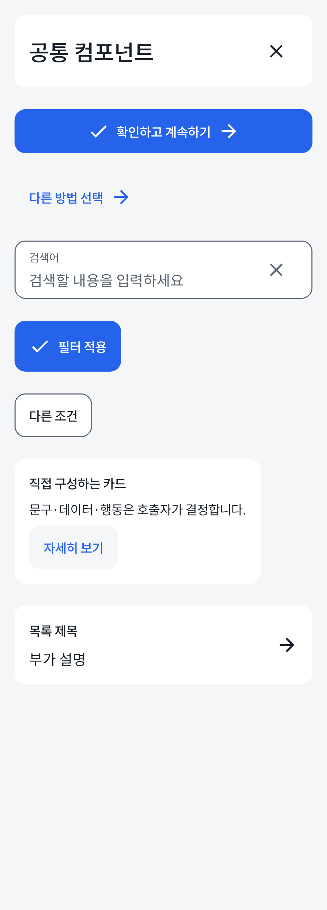
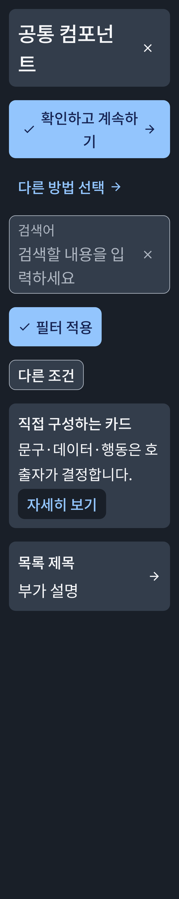
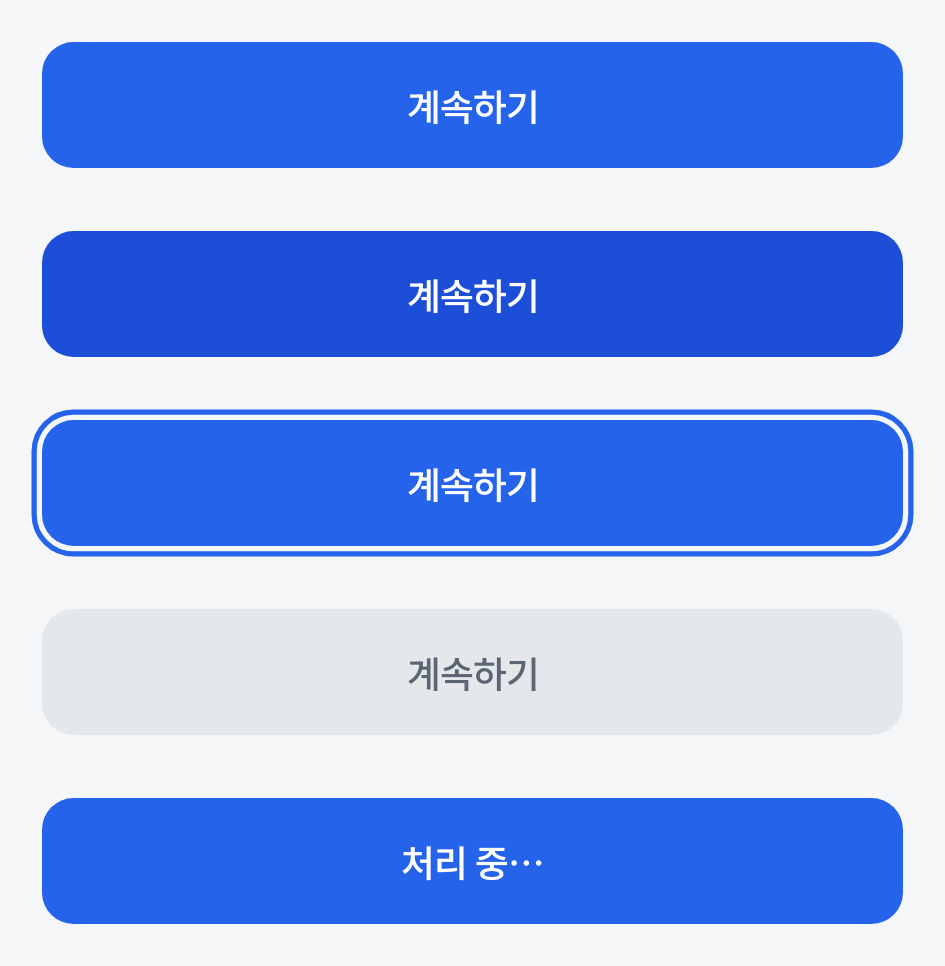
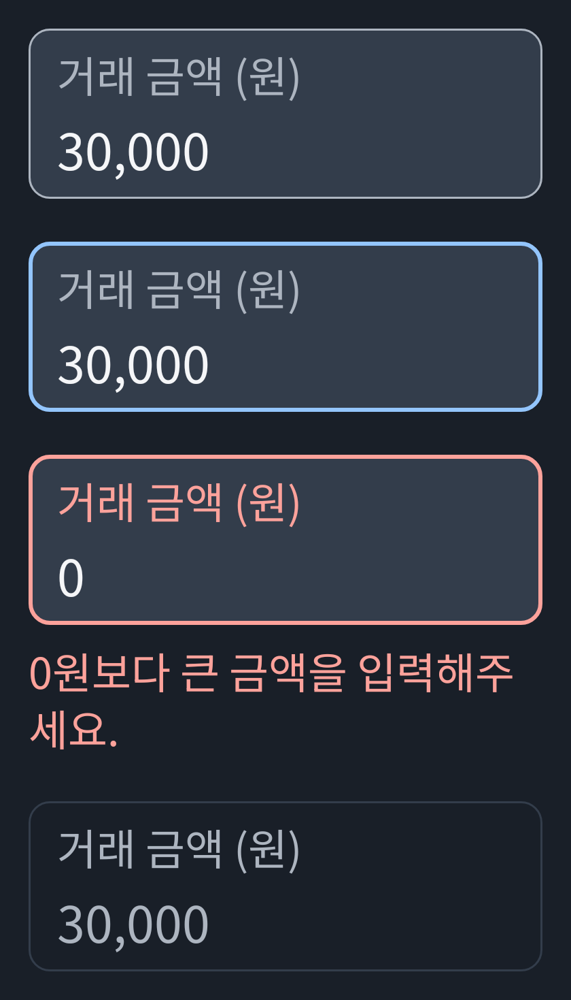
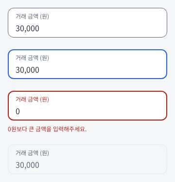
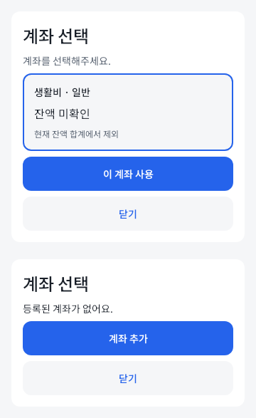
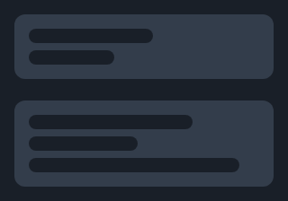
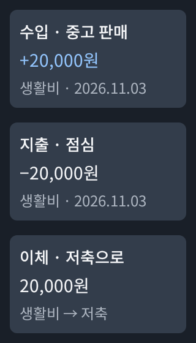

# MONIT 디자인 시스템

Material 3 Compose 기반 공통 UI와 테마를 제공한다. 기기 Light/Dark를 따르고 동적 색상은 사용하지 않는다.
색상·타이포·간격·크기는 [theme](src/main/kotlin/com/monit/core/designsystem/theme)에서 관리한다.

## 공통 API와 화면 조합

`component`에는 여러 화면에서 재사용하는 표현·입력·컨테이너를 둔다. 기본값으로 바로 사용하고 필요한 타입·크기·색상·콘텐츠 슬롯만 지정한다. 데이터 조회·금융 정책·화면
이동은 호출자가 담당한다.

정확한 매개변수·기본값은 [공개 API 원본](src/main/kotlin/com/monit/core/designsystem/component)에서 확인한다. 아래 표는 용도와
확장 지점이다.

| 공통 API                                                  | 호출자가 바꿀 수 있는 내용                                                 |
|---------------------------------------------------------|-----------------------------------------------------------------|
| `MonitButton`                                           | Primary/Secondary, Regular/Compact, 상태별 색상, 앞뒤 아이콘, 활성·처리 상태·콜백 |
| `MonitTextField`                                        | 라벨·힌트·앞뒤 아이콘, 키보드/IME, 읽기 전용·여러 줄, 색상·글자 스타일·모양·패딩              |
| `MonitCard`·`MonitSelectableCard`                       | 내용·패딩·배치·색상·모양, 선택 값·역할·비활성 사유                                  |
| `MonitListItem`                                         | 제목·보조/상세 내용·앞뒤 콘텐츠, 선택적 클릭                                      |
| `MonitBottomSheet`·`MonitDialog`                        | 제목·본문·행동 슬롯, 닫기 및 스크롤/모달 옵션                                     |
| `MonitTopBar`                                           | 제목 스타일, 탐색 아이콘·우측 행동, 색상                                        |
| `MonitFilterChip`·`MonitBadge`                          | 라벨·상태, 칩의 Filled/Outlined·Regular/Compact·색상·배치·앞뒤 아이콘          |
| `MonitBottomNavigation`·`MonitSegmentedControl`         | 목적지/선택지·선택 값·콜백, 탐색 아이콘·활성 여부                                   |
| `MonitStatusPanel`·`MonitSnackbar`                      | 안내 문구·아이콘/행동 슬롯. 상태 판정과 표시 수명은 호출자 책임                           |
| `MonitSkeleton`                                         | 줄 개수·폭 비율·높이·막대 모양                                              |
| `MonitDateCell`·`MonitCalendarHeader`·`MonitDatePicker` | 날짜·월·선택 값·설명·이동/선택 콜백·선택 가능 정책                                  |

계좌 목록 조회·ID 선택·명시적 적용, 거래 행, 월 수입/지출 요약, 납입 상태 조합은 공개 공통 API가
아니다. [preview](src/main/kotlin/com/monit/core/designsystem/preview)의 internal 합성 예시로 공통 컴포넌트를 조합한다.
실제 제품 구현 시 해당 조합과 정책은 feature의 화면 컴포넌트에 둔다. 현재 제품 화면이나 feature 모듈은 생성하지 않았다.

```kotlin
MonitButton(
    text = "확인",
    type = MonitButtonType.Secondary,
    size = MonitButtonSize.Compact,
    leadingIcon = { Icon(Icons.Filled.Check, contentDescription = null) },
) {
    onConfirm()
}

MonitTextField(
    value = query,
    onValueChange = onQueryChange,
    label = "검색어",
    keyboardOptions = KeyboardOptions(imeAction = ImeAction.Search),
    keyboardActions = KeyboardActions(onSearch = { onSearch(query) }),
    placeholder = { Text("검색할 내용을 입력하세요") },
)

MonitCard {
    Text(title)
    Text(description)
    MonitButton("자세히 보기", onClick = onDetails)
}
```

버튼·칩·입력은 각 `Defaults.colors(...).copy(...)`와 `Defaults.layout(...).copy(...)`로 필요한 역할만 바꾼다. 프리셋은
기본값이며 직접 생성한 색상·배치 값도 전달할 수 있다. 렌더링은 해석된 값만 사용하고 화면이 누름/비활성 색을 따로 판정하지 않는다.

## 컴포넌트 경계와 파일 책임

| 디렉터리                                                                         | 역할별 파일                                                                                                               |
|------------------------------------------------------------------------------|----------------------------------------------------------------------------------------------------------------------|
| [button](src/main/kotlin/com/monit/core/designsystem/component/button)       | `MonitButton`, `MonitButtonType`, `MonitButtonSize`, `MonitButtonColors`, `MonitButtonLayout`, `MonitButtonDefaults` |
| [chip](src/main/kotlin/com/monit/core/designsystem/component/chip)           | `MonitFilterChip`, `MonitChipType`, `MonitChipSize`, `MonitChipColors`, `MonitChipLayout`, `MonitChipDefaults`       |
| [textfield](src/main/kotlin/com/monit/core/designsystem/component/textfield) | `MonitTextField`, `MonitTextFieldColors`, `MonitTextFieldLayout`, `MonitTextFieldDefaults`                           |

Type/Size는 프리셋 선택, Colors/Layout은 불변 설정 값, Defaults는 테마 해석, 컴포넌트 본문은 입력·접근성·렌더링을 담당한다. Type/Size와
Colors/Layout은 앱·화면·테마를 참조하지 않는다. 컴포넌트는 다른 종류의 공통 컴포넌트 구현을 호출하지 않으며, 달력의 셀·헤더·선택기는
같은 [calendar](src/main/kotlin/com/monit/core/designsystem/component/calendar) 조합 범위다. 공통 테마와
Compose/Material 의존은 라이브러리 기반으로 명시적으로 유지한다.

기본 테마를 쓸 때는 호스트에서 `MonitTheme`를 적용한다. 다른 테마와 통합할 때는 호스트가 해석한 Colors/Layout을 명시적으로 전달할 수 있다.

다음 검증은 기존 빌드의 Compose compiler를 사용해 선택한 family와 공통 theme만 별도 출력 경로에 컴파일한다. 앱·data·model·다른 컴포넌트 클래스는
classpath에 허용하지 않으며 해당 라이브러리의 리소스 심벌만 사용한다. 프로젝트 캐시도 family별 경로로 분리하고 원본 소스·설정 파일은 쓰지 않는다. 프로젝트의 모듈
구조나 저장소를 추가하지 않는다.

```powershell
# button, chip, textfield를 각각 실행한다.
.\gradlew.bat :core:designsystem:compileDebugKotlin --init-script scripts/verify-component.init.gradle.kts -Pmonit.component=button -Pkotlin.incremental=false --project-cache-dir core/designsystem/build/component-compilation/project-cache/button --console=plain
```

[검증 스크립트](../../scripts/verify-component.init.gradle.kts)는 위 단일 작업에서만 동작한다. 일반 앱 빌드·테스트는 init script
없이 실행한다. 이 검증은 소스/의존 경계 확인이며 별도 SDK의 배포·버전 호환성 인증을 뜻하지 않는다.

## 디자인 원본과 대응

시각 원본은 선택된 팀의 Folders → MONIT에
있는 [Foundations](https://www.figma.com/design/7jkAht5c7RtQ0DkZ9QFxXw?node-id=127-1028), [19개 원본](https://www.figma.com/design/7jkAht5c7RtQ0DkZ9QFxXw?node-id=120-1086), [현재 인계](https://www.figma.com/design/7jkAht5c7RtQ0DkZ9QFxXw?node-id=131-2)
다. 아래 family는 설계 분류이며 공개 API나 제품 기능의 개수를 뜻하지 않는다.

| Figma family · master                                                                             | 공통 구현/조합 예시                  | 카탈로그 상태                                                 |
|---------------------------------------------------------------------------------------------------|------------------------------|---------------------------------------------------------|
| [ActionButton · 127:995](https://www.figma.com/design/7jkAht5c7RtQ0DkZ9QFxXw?node-id=127-995)     | `MonitButton`                | Default·Pressed·Focused·Disabled·Loading                |
| [Field · 109:284](https://www.figma.com/design/7jkAht5c7RtQ0DkZ9QFxXw?node-id=109-284)            | `MonitTextField`의 금액 입력 예시   | Default·Focused·Error·Disabled                          |
| [AccountCard · 109:381](https://www.figma.com/design/7jkAht5c7RtQ0DkZ9QFxXw?node-id=109-381)      | `MonitSelectableCard` 조합     | Unknown·Selected·Disabled·Confirmed(표시 예시)              |
| [TransactionRow · 109:367](https://www.figma.com/design/7jkAht5c7RtQ0DkZ9QFxXw?node-id=109-367)   | `MonitListItem` 조합           | Income·Expense·Transfer                                 |
| [CalendarCell · 113:404](https://www.figma.com/design/7jkAht5c7RtQ0DkZ9QFxXw?node-id=113-404)     | `MonitDateCell`              | Default·Today·Selected·Future·Blank                     |
| [Badge · 109:223](https://www.figma.com/design/7jkAht5c7RtQ0DkZ9QFxXw?node-id=109-223)            | `MonitBadge`                 | Neutral·Selected·Error·Disabled                         |
| [FilterChip · 109:231](https://www.figma.com/design/7jkAht5c7RtQ0DkZ9QFxXw?node-id=109-231)       | `MonitFilterChip`            | Default·Selected·Disabled                               |
| [TopBar · 109:238](https://www.figma.com/design/7jkAht5c7RtQ0DkZ9QFxXw?node-id=109-238)           | `MonitTopBar`와 탐색 아이콘        | Root·Back·Close                                         |
| [SegmentedControl · 109:253](https://www.figma.com/design/7jkAht5c7RtQ0DkZ9QFxXw?node-id=109-253) | `MonitSegmentedControl`      | Expense·Income·Transfer·Calendar·List                   |
| [StatusPanel · 109:335](https://www.figma.com/design/7jkAht5c7RtQ0DkZ9QFxXw?node-id=109-335)      | `MonitStatusPanel`과 행동 슬롯    | Empty·Loading·Error·Saving·Checking·CheckFailed·Success |
| [MonthSummary · 109:396](https://www.figma.com/design/7jkAht5c7RtQ0DkZ9QFxXw?node-id=109-396)     | `MonitCard` 조합               | Normal·Empty                                            |
| [BottomNavigation · 113:333](https://www.figma.com/design/7jkAht5c7RtQ0DkZ9QFxXw?node-id=113-333) | `MonitBottomNavigation`      | Overview·Transactions·Accounts                          |
| [BottomSheet · 113:354](https://www.figma.com/design/7jkAht5c7RtQ0DkZ9QFxXw?node-id=113-354)      | `MonitBottomSheet` 본문과 계좌 예시 | Account·Empty                                           |
| [Dialog · 113:373](https://www.figma.com/design/7jkAht5c7RtQ0DkZ9QFxXw?node-id=113-373)           | `MonitDialog` 본문과 버튼 조합      | Discard·DeleteFuture(비활성 예시)                            |
| [Snackbar · 113:388](https://www.figma.com/design/7jkAht5c7RtQ0DkZ9QFxXw?node-id=113-388)         | `MonitSnackbar`              | Saved·Retry                                             |
| [Skeleton · 113:393](https://www.figma.com/design/7jkAht5c7RtQ0DkZ9QFxXw?node-id=113-393)         | `MonitSkeleton`의 줄 구성        | Row·Card                                                |
| [CalendarHeader · 113:426](https://www.figma.com/design/7jkAht5c7RtQ0DkZ9QFxXw?node-id=113-426)   | `MonitCalendarHeader`        | Month                                                   |
| [PaymentStatusRow · 113:437](https://www.figma.com/design/7jkAht5c7RtQ0DkZ9QFxXw?node-id=113-437) | `MonitCard` 조합               | Pending·Completed·Skipped(표시 예시)                        |
| [DatePicker · 113:449](https://www.figma.com/design/7jkAht5c7RtQ0DkZ9QFxXw?node-id=113-449)       | `MonitDatePicker`            | Selected·Error                                          |

기본 설계 좌표는 360×780, 좌우 16·콘텐츠 328, 달력은 좌우 12·콘텐츠 336이다. 고정 기기 크기로 구현하지 않는다. Figma Variables·Text
Styles는 변경하지 않았다.

- Regular 버튼은 현재 Compose의 좌우 24·상하 12 패딩을 유지한다. Figma의 세로 패딩 0·중앙 정렬·최소 높이 48과 같은 패딩 명세라고 해석하지 않는다.
  큰 글꼴에서는 내용에 맞춰 높이를 늘린다.
- Compact는 기존 간격을 조합한 API 사용 예시다. 좌우 16·상하 8·아이콘 24·간격 8·최소 터치 높이 48이며 Figma 원본의 추가 variant가 아니다.
- 칩의 Outlined·Compact도 API 조합 예시이며 Figma 원본에는 기본 Filled·Regular를 대응한다. 칩은 Checkbox 역할과 체크 상태를 함께
  전달한다.
- Secondary는 surface 배경과 primary 글자 역할을 사용한다. 탐색 아이콘은 Material 아이콘과 AutoMirrored 화살표를 조합한다.
- `MaterialTheme.shapes.extraSmall`은 기존 `fieldRadius=4dp`를 유지한다. 공통 TextField는 승인된 입력 규격에 맞춰
  `controlRadius=12dp`를 기본 shape로 명시한다.
- Dark Skeleton은 `disabledBackground`와 `surfaceContainer`가 같아 바에만 기존 `surface`를 쓴다. 전역 disabled 색은
  유지한다.
- 선택·비활성 날짜에는 disabled 배경/글자와 primary 외곽선을 사용한다. 카탈로그에 이 복합 상태 예시를 추가한다.

## 입력·상호작용 계약

- 버튼의 앞뒤 아이콘은 텍스트 행동의 장식으로 하나의 클릭 대상에 포함한다. disabled/loading은 입력을 잠근다. 둘이 겹치면 disabled 색을 우선하고 진행
  문구·설명은 유지한다. 안내 기본값은 일반 진행 안내다. 이 버튼만 ripple을 제거하고 자체 누름 색·외부 포커스 링을 제공한다. 주변 4dp를 clip하지 않는다.
- 입력은 빈칸·부호·소수·붙여넣기 문자열을 강제 변환하지 않으며 일반 편집의 커서 관리는 BasicTextField에 맡긴다. 외부 값 교체·포맷 변경·화면 복원의 커서 위치까지
  보장하는 API는 아니다. 오류와 진행 설명을 라벨에 연결하고 타이핑마다 live announcement를 만들지 않는다. 별도 행동이 있는 입력 아이콘은 호출자가 설명·활성
  여부·콜백을 정한다.
- 선택 카드는 전달된 선택/활성 값과 사유를 표시한다. 계좌·잔액·사용자 식별 모델을 받지 않는다. 목록 항목도 전달된 콘텐츠만 배치한다.
- 시트는 `LocalWindowInfo`의 현재 창 높이 90%에서 제목·행동을 고정한다. 시스템 영역·IME 높이를 직접 빼는 추가 계산은 없고 M3 모달의 기본 insets
  처리를 사용한다. 본문 스크롤은 끌 수 있으므로 Lazy 목록은 `scrollContent=false`로 구성한다. 닫기 허용 여부는 호출자가 정하며 선택
  검증·적용·추가·재시도·복귀 초점은 화면 책임이다.
- 날짜 선택기는 표시 월·선택일·오늘·선택 가능 정책을 받는다. 월 변경 시 선택일 보정과 기록 정책은 소유자가 처리한다. 빈 날짜는 비상호작용이며 320dp/큰 글꼴에서는
  7열을 줄이지 않고 가로 스크롤한다.
- 상태 패널은 결과를 판정하지 않는다. 스낵바는 `SnackbarHost` 슬롯에서 수명을 관리한다. 모달 Preview는 같은 본문을 사용하며 실제 모달 동작 검증을 대신하지
  않는다.

상태바·시스템 내비게이션은 OS 영역이다. 실제 화면의 `WindowInsets`·외부 padding 연결은 feature 화면 구현 단계에서 관리하고, 공통 모달은 현재 M3
기본 insets 처리를 사용한다.

## 공통 클릭 Modifier

[MonitClickModifiers.kt](src/main/kotlin/com/monit/core/designsystem/modifier/MonitClickModifiers.kt)
의 `clickableWithoutRipple`은 직접 시각 피드백을 제공하는 대상에 사용하며 enabled·role·label·키보드·포커스를 유지한다.
`clickableWithCooldown`은 첫 클릭을 즉시 허용하고 마지막 수락 시점부터 간격을 센다. 억제 클릭은 간격을 연장하지 않으며 재구성 뒤에도 최신 콜백을 호출한다.

cooldown Modifier는 대상마다 생성한다. 반환 Modifier를 공유하면 gate도 공유하며 비활성 전환은 마지막 시점을 지우지 않는다. 간격을 바꾸면 새 간격을
적용하고 composition에서 제거되면 gate도 사라진다. 기본 ripple을 유지하며 선택적으로 끌 수 있다. 최소 터치 영역과 시각 피드백은 호출자가 보장하고 M3
Button에 clickable을 중첩하지 않는다. UI cooldown은 Repository의 금융 idempotency를 대신하지 않는다.

## Preview와 검증

[family 카탈로그](src/main/kotlin/com/monit/core/designsystem/preview/MonitFamilyPreviews.kt)는 19개 설계
family × Light/Dark 360dp 및 320dp/200%의 76조건을
제공한다. [공통 API 사용 예시](src/main/kotlin/com/monit/core/designsystem/preview/MonitUsagePreviews.kt)는 별도
네 조건에서 커스텀 조합을 보여준다. Hilt·DB·네트워크 없이 고정 날짜와 합성 데이터만
사용한다. [Figma Prevue 대응표](https://www.figma.com/design/7jkAht5c7RtQ0DkZ9QFxXw?node-id=98-796)와 함께
비교한다.

버튼과 입력의 정적 상태는 공개 API와 동일한 internal 본문에 누름·포커스 값을 명시한다. 시각 코드를 복제하지 않으며 공개 API는 interaction을 수집한다. 긴
카탈로그는 Preview 높이를 지정하고 마지막 상태/오류 문구까지 확인한다. 정적 PNG의 상태 재현·런타임 이벤트 처리·실기기 검증을 구분한다.

```powershell
.\gradlew.bat :core:designsystem:testDebugUnitTest :app:assembleDebug :core:designsystem:lintDebug :app:lintDebug --console=plain
```

테스트는 기본 동작·키보드/IME·잠금·선택·큰 글꼴, 클릭 Modifier, 타입/크기/슬롯 조합, 진행 라벨과 Android 편집 노드 정보, interaction 이벤트의
색상 변경·복귀를 검사한다. 합성 금융 조합 시험은 실제 금융 기능 통과를 뜻하지 않는다. `MonitCatalogRenderTest`의 Native Canvas 호스트 PNG는
76개 설계 조건과 네 사용 예시를 생성하며 Prevue·자동 픽셀 일치·실기기 성공 증거가 아니다. 실제 Prevue의 대상 head·입력·확인 범위는 PR에서 관리한다.

Android Studio에서는 `MonitFamilyPreviews.kt`와 `MonitUsagePreviews.kt`의 Preview를 연다. 기존 Prevue 0.21.0이
준비된 WSL/Linux에서는 JDK 21·Linux Android SDK와 실행 파일 경로 `PREVUE_CLI`를 지정하고 저장소 루트에서 실행한다. 다음은 Ubuntu 환경
예시다.

```bash
export JAVA_HOME=/usr/lib/jvm/java-21-openjdk-amd64
export PREVUE_JDK="$JAVA_HOME"
export ANDROID_HOME="$HOME/Android/Sdk"
export ANDROID_SDK_ROOT="$ANDROID_HOME"
bash "$PREVUE_CLI" --lang ko show "$PWD/core/designsystem/src/main/kotlin/com/monit/core/designsystem/preview/MonitFamilyPreviews.kt"
# 공통 API 조합은 같은 명령의 파일을 MonitUsagePreviews.kt로 바꾼다.
```

viewer 주소·포트는 실행 응답을 사용한다. 환경 준비 요청이나 캐시 불일치가 있으면 기존 환경의 health 확인·준비 절차를 거치며 자동 설치 성공으로 간주하지 않는다.
Light/Dark·360dp·320dp/200%를 선택해 마지막 상태와 오류 문구까지 확인한다. 정적 첫 캡처와 입력 이벤트 시험은 별도로 다룬다.

Prevue 정적 첫 캡처:

| 공통 API 사용 예시 · Light 360dp               | 공통 API 사용 예시 · Dark 320dp/200%                |
|------------------------------------------|-----------------------------------------------|
|  |  |

| Light 버튼 · 360dp                                  | Dark 입력 · 320dp/200%                               |
|---------------------------------------------------|----------------------------------------------------|
|  |  |

호스트 렌더:

| Light 입력 · 360dp                       | Light 시트 조합 · 360dp                          |
|----------------------------------------|----------------------------------------------|
|  |  |

| Dark Skeleton · 320dp/200%                  | Dark 목록 조합 · 320dp/200%                               |
|---------------------------------------------|-------------------------------------------------------|
|  |  |

실기기 TalkBack·터치·IME·시스템 바/insets·모달 복귀 초점과 제품 화면의 저장/복구 연결은 별도 검증 범위다. 지정 기기가 연결되지 않으면 다른 기기로 대체해 통과
처리하지 않는다.

## 글꼴과 라이선스

[공식 google/fonts Noto Sans KR](https://github.com/google/fonts/tree/b38c5c93af322c45f633e17ac440ec1e6c94d489/ofl/notosanskr)
의 variable TTF를 수정 없이 포함한다. 400/500 weight를 명시하고 실행 시 네트워크를 사용하지 않는다. 라이선스는 APK의
`assets/fonts/NotoSansKR-OFL.txt`에 포함한다.

- 고정 revision: `b38c5c93af322c45f633e17ac440ec1e6c94d489`
- SHA-256: `194018e6b2b293a7964f037b25c0249ce1418bc9ab3c971060a03aa57861e252`
- 크기: 10,414,588 bytes. 폰트 분할/서브셋 최적화는 별도 검토한다.
