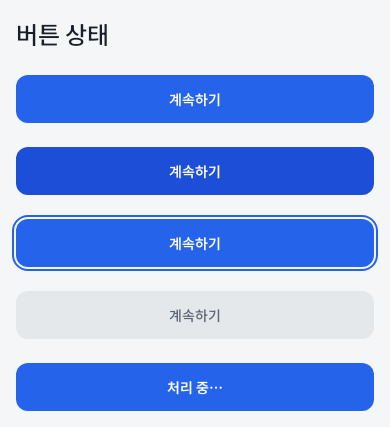
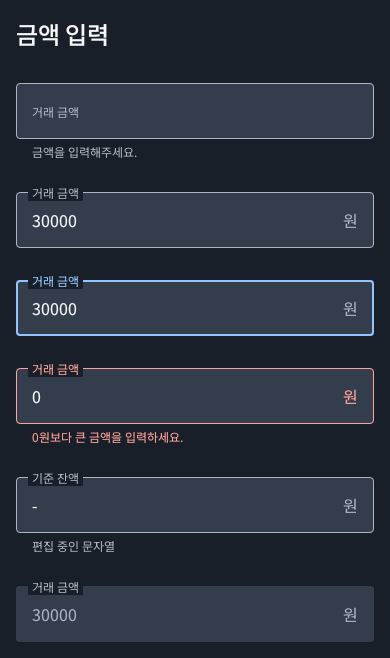
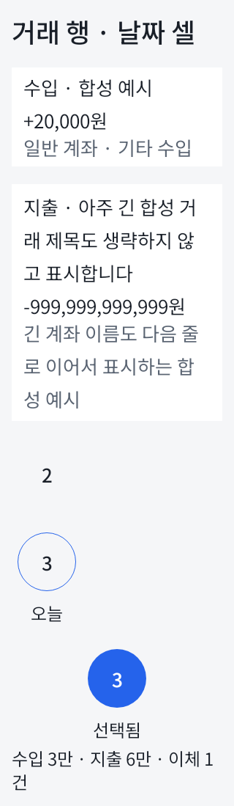
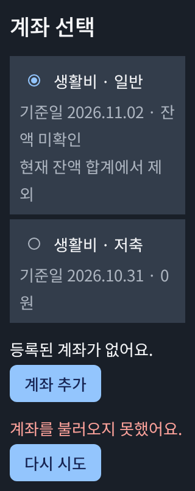

# MONIT 디자인 시스템

기기 설정을 따르는 Light/Dark 테마, 동적 색상 비사용, 기존 파란색과 M3+SEED 의미/상태 대응을 적용한다. 제품 기능 화면은 포함하지 않는다. app의 기존 MONIT 임시 런처에 테마만 연결하며 Room·서버·금융 계산에는 의존하지 않는다.

## 최신 Figma와 읽는 순서

2026-11-10 Design의 최종 인계를 반영했다. 시각·토큰 원본은 선택된 팀의 Folders → MONIT에 있는 Figma이며, 실행 가능한 컴포넌트의 원본은 이 모듈이다. 이번 Figma 개편을 Compose 전체 구현 완료로 해석하지 않는다.

| 읽는 순서 | Figma 바로가기 | 확인할 내용 |
|---|---|---|
| 1. 시작 안내 | [00 · Start here](https://www.figma.com/design/7jkAht5c7RtQ0DkZ9QFxXw?node-id=123-2) | 현재 원본, 페이지 구성과 전달 상태 |
| 2. 디자인 시스템 | [Foundations](https://www.figma.com/design/7jkAht5c7RtQ0DkZ9QFxXw?node-id=127-1028), [원본 컴포넌트](https://www.figma.com/design/7jkAht5c7RtQ0DkZ9QFxXw?node-id=120-1086) | 토큰·타입과 재사용 가능한 컴포넌트·Variant |
| 3. 사용 예시 | [공통 패턴과 상태](https://www.figma.com/design/7jkAht5c7RtQ0DkZ9QFxXw?node-id=112-188), [탐색과 피드백](https://www.figma.com/design/7jkAht5c7RtQ0DkZ9QFxXw?node-id=113-807) | 조합·상태별 사용 예시. 원본 컴포넌트와 구분 |
| 4. 와이어프레임 | [02 · Wireframes](https://www.figma.com/design/7jkAht5c7RtQ0DkZ9QFxXw?node-id=122-2) | 정보 배치와 조회 → 입력 → 계좌 등록·선택 → 저장·결과 확인 동선 |
| 5. 화면 디자인 | [03 · Screen Design](https://www.figma.com/design/7jkAht5c7RtQ0DkZ9QFxXw?node-id=7-2325) | 기능별 화면과 정상·빈 화면·오류·진행 상태 |
| 6. 개발 전달 | [현재 전달 기준](https://www.figma.com/design/7jkAht5c7RtQ0DkZ9QFxXw?node-id=131-2), [Prevue 대응표](https://www.figma.com/design/7jkAht5c7RtQ0DkZ9QFxXw?node-id=98-796) | 이전→현재 참조, 구현 대상과 검증 경계 |
| 이전 자료 | [90 · Archive](https://www.figma.com/design/7jkAht5c7RtQ0DkZ9QFxXw?node-id=48-141) | 기존 디자인 시스템·SEED 대응 명세. 새 구현의 최신 원본으로 사용하지 않음 |

### 설계된 자산과 구현된 자산

Figma에는 `MONIT/` 컴포넌트 19종·Variant 62개가 있다. Variables 45개와 Text Styles 5개의 값·모드·정의는 유지했으며 새 컴포넌트에 연결했다. 전체 토큰 값과 상태 표는 Figma에서 관리한다.

| Figma 구성 | 현재 Compose 대응 |
|---|---|
| ActionButton, Field, TransactionRow, CalendarCell | 기존 `MonitButton`, `MonitAmountField`, `MonitTransactionRow`, `MonitDateCell`이 관련 역할을 구현한다. 최신 Figma와의 상태·치수 일치는 별도 대조 필요 |
| AccountCard, BottomSheet | 기존 `MonitAccountPicker`는 계좌 선택을 제공하지만 최신 카드·시트 전체를 구현한 것은 아님 |
| Badge, FilterChip, TopBar, SegmentedControl, StatusPanel, MonthSummary, BottomNavigation, Dialog, Snackbar, Skeleton, CalendarHeader, PaymentStatusRow, DatePicker | Figma 설계 확장. 같은 이름의 공통 Compose API가 이 모듈에 구현됐다고 가정하지 않음 |

화면 프레임 52개는 **Light 상태별 프레임 48개와 대표 Dark 4개**이며 독립 기능 52개가 아니다. 와이어프레임은 8개다. 루틴·납입 연결·기준액 확인·편집·삭제 등 후속 기능의 화면도 설계 자료로 포함되며 앱 구현 완료를 뜻하지 않는다.

설계 기준은 360 × 780, 일반 콘텐츠 폭 328, 달력 폭 336·날짜 터치 영역 48이다. 이는 Figma 좌표이며 Android에서는 dp/sp와 가변 레이아웃으로 해석한다. 360 너비나 780 높이를 모든 기기에 고정하지 않는다. Design은 화면 크기와 중첩 요소의 가로 넘침 없음, 대표 Light/Dark를 확인했다. 새 설계의 320dp·글자 200%·TalkBack·IME·실기기·Prevue 렌더 비교는 미검증이다. 아래 기존 Compose 테스트 결과와 구분한다.

## 기존 Compose 구현의 참조 기준

아래는 2026-11-09 구현 시 확인한 노드의 design context·스크린샷과 Compose Code Connect 참조다. 개편 이후에도 기존 노드 링크를 보존했으므로 **구현 근거 추적용**으로 남긴다. 새 구현은 위 최신 전달 기준부터 확인한다. 테마 정책은 기기 Light/Dark·동적 색상 비사용으로 유지된다.

| Figma 원본 | 구현 |
| --- | --- |
| [Foundations 40:12](https://www.figma.com/design/7jkAht5c7RtQ0DkZ9QFxXw?node-id=40-12) | `theme/MonitColors.kt`, `MonitTypography.kt`, `MonitTheme.kt` |
| [버튼 3:15](https://www.figma.com/design/7jkAht5c7RtQ0DkZ9QFxXw?node-id=3-15) | `MonitButton`: Default/Pressed/Focused/Disabled/Loading |
| [입력·행·날짜 상태 40:103](https://www.figma.com/design/7jkAht5c7RtQ0DkZ9QFxXw?node-id=40-103) | `MonitAmountField`, `MonitTransactionRow`, `MonitDateCell` |
| [계좌 선택 54:823](https://www.figma.com/design/7jkAht5c7RtQ0DkZ9QFxXw?node-id=54-823) | `MonitAccountPicker`: 선택·미선택·미등록·잠금·실패/재시도 |
| [접근성 33:1346](https://www.figma.com/design/7jkAht5c7RtQ0DkZ9QFxXw?node-id=33-1346), [전달 보완 54:906](https://www.figma.com/design/7jkAht5c7RtQ0DkZ9QFxXw?node-id=54-906) | 가변 높이·48dp·통합 semantics·편집 문자열 보존 |

전달된 54:754는 실제 계좌 이름 필드다. 금액 입력의 실제 참조는 40:112/122/132/152와 상위 40:103을 사용했다. `OutlinedTextField`, `RadioButton`, `ListItem`은 기존 M3 Compose 매핑을 재사용했다. 날짜 셀의 Figma `.Building Blocks/Local M3 calendar cell`은 프로젝트에 존재하는 공개 Compose API가 아니므로, 조회된 48dp 터치 영역/40dp 표시 원과 상태를 Compose 기본 요소로 구성했다. 별도 Code Connect 등록·Figma 쓰기는 수행하지 않았다.

5개 글자 스타일은 titleLarge(Title), bodyMedium(Body), labelLarge(Label), bodyLarge(Input), labelSmall(Caption)에 대응한다. 수치는 코드에서 관리하고 이 문서에 전체 토큰 표를 복제하지 않는다. M3에 별도 값이 필요한 나머지 역할은 승인된 semantic 쌍으로 연결하고, 새 기능별 색상 의미를 만들지 않는다. SEED 공식 Compose SDK나 토큰의 1:1 복제를 주장하지 않는다.

## 컴포넌트 사용 경계

- `MonitButton`은 loading/disabled일 때 콜백을 차단하고 loading을 말로 알린다. 누름 색상과 포커스 링이 M3 기본 state layer와 이중 적용되지 않도록 해당 버튼에서만 ripple 설정을 조정한다. 포커스 외곽선이 잘리지 않게 주변 4dp를 확보한다. 저장 원자성과 중복 방지는 Repository의 별도 책임이다.
- `MonitAmountField`는 문자열을 그대로 소유자에게 전달한다. 전체 삭제·단독 `-`·소수·매우 긴 붙여넣기를 0원이나 유효 정수로 바꾸지 않는다. 천 단위 자동 변환도 하지 않는다. 호출자는 제출/포커스 이동 시 L1 검증·오류 공개·첫 오류 이동을 처리하고 `KeyboardActions`에서 IME 완료도 같은 검증 경로로 보낸다. 숫자 키보드는 검증 수단이 아니다.
- `MonitAccountPicker`의 `MonitAccountOption`은 표시 값이다. ID는 항목별로 유일해야 한다. 같은 이름을 ID로 구별하며 선택 콜백은 해당 ID만 반환한다. `balanceText=null`은 ‘잔액 미확인/합계 제외’, `"0원"`은 확인한 0원이다. 라디오와 행은 한 선택 대상으로 읽으며, 선택 불가 사유·전체 잠금을 처리한다. 오류가 있을 때 빈 목록을 ‘등록된 계좌 없음’으로 단정하지 않는다. 추가/재시도·반대편 계좌 제한·화면 복귀 초점은 호출자의 책임이다.
- `MonitTransactionRow`는 종류·정확한 금액·계좌 라벨을 받아 줄바꿈한다. 수입/지출을 색상만으로 구별하지 않으며 계산·반올림·단위 축약을 수행하지 않는다.
- `MonitDateCell`은 연도·월·일·요일·오늘·선택·요약을 하나의 읽기/선택 대상으로 묶는다. `date=null`은 이웃 월 빈칸으로 비활성이다. 미래 조회는 가능하며 미래 기록 허용 여부는 판단하지 않는다. 셀은 최소 48dp, 확대 시 늘어난다. 실제 7열 달력은 최소 폭을 유지하며 가로 스크롤/목록 전환을 제공해야 하고, 이 모듈은 달력 화면을 만들지 않는다. 축약 요약에는 정확한 `accessibilitySummary`를 함께 준다.

## 글꼴과 라이선스

[공식 google/fonts Noto Sans KR](https://github.com/google/fonts/tree/b38c5c93af322c45f633e17ac440ec1e6c94d489/ofl/notosanskr)의 variable TTF를 수정 없이 포함한다. 400/500 weight를 명시하며 폰트 다운로드 서비스·실행 시 네트워크를 사용하지 않는다. 원본 `OFL.txt`는 줄끝 공백 한 곳만 정리하여 APK의 `assets/fonts/NotoSansKR-OFL.txt`에 함께 배포한다.

- 고정 revision: `b38c5c93af322c45f633e17ac440ec1e6c94d489`
- SHA-256: `194018e6b2b293a7964f037b25c0249ce1418bc9ab3c971060a03aa57861e252`
- 원본 파일 크기: 10,414,588 bytes. 이 첫 구현은 전체 글리프를 포함하며 APK 크기 영향이 있다. 폰트 분할/서브셋 최적화는 별도 검토한다.

## 검증과 한계

```powershell
.\gradlew.bat :core:model:test testDebugUnitTest assembleDebug lintDebug --console=plain
```

기존 CI의 루트 task selector가 새 Android 모듈도 검사한다. Compose/Robolectric 시험은 시스템 테마 전환·대비·잠금·문자열/IME·ID 선택·미확인/0원·통합 semantics·최소 터치/글자 확대·키보드 포커스를 검사한다. 새 기능 시험이므로 수정 전 실패를 일괄 요구하지 않는다.

`MonitCatalogRenderTest` 전체 실행은 390dp/100%와 320dp/200%, Light/Dark 각각의 버튼·입력·계좌·행/날짜 16개 이미지를 만든다. 호스트 API 28의 PixelCopy 콜백 대기 문제를 피하기 위해 실제 View를 Native Canvas에 동기 렌더한다. PNG는 `build/reports/designsystem/screenshots/testDebugUnitTest`에 있으며 Gradle Test task의 출력으로 선언해 캐시 복원에도 포함한다. task별 폴더를 분리하고 JVM 속성에는 모듈 기준 상대 경로를 전달한다. 실제 task 실행 전에는 이전 이미지를 정리하므로 필터 실행은 해당 조건 이미지만 남긴다. UP-TO-DATE/캐시 복원에서는 정리 동작을 실행하지 않는다. 자동 픽셀 기준 회귀 테스트·실기기 렌더 통과를 뜻하지 않는다.

Preview와 테스트 카탈로그는 합성 데이터만 사용한다. 실제 기기의 TalkBack 읽기 순서·키보드/IME·시스템 바/insets·강제 테마 전환은 별도 확인이 필요하다. 제품 화면의 오류 초점 이동·저장/복귀·7열 그리드는 후속 구현에서 검증한다.

### 검토용 호스트 렌더

대표 4개는 코드 검토를 위해 보관한다. 픽셀 자동 기준선이 아니며 나머지 상태는 테스트 실행으로 생성한다.

| Light 버튼 · 390dp/100% | Dark 입력 · 390dp/100% |
| --- | --- |
|  |  |

| Light 행/날짜 · 320dp/200% | Dark 계좌 · 320dp/200% |
| --- | --- |
|  |  |
