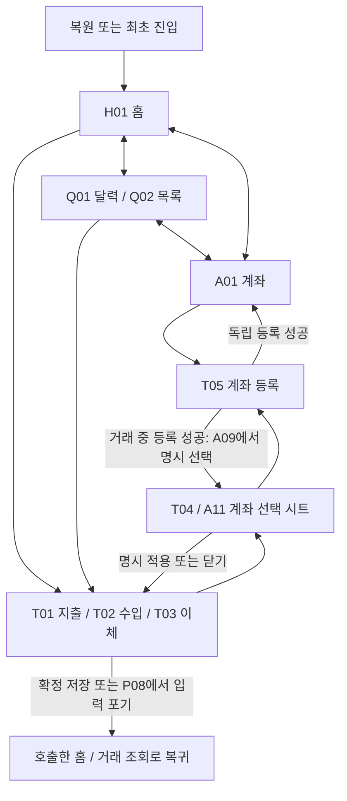

# Navigation 2 화면 이동 설계안

- 상태: 검토용 제안. 제품 코드·모듈·의존성 추가와 구현 승인을 포함하지 않는다.
- MONIT 기준: main `43ba391a3801f502321052c62032bf7e2d4488fc` (#15·#24 병합). 관련 작업은 [#28](https://github.com/1971123-seongmin/MONIT/issues/28)이다.
- 목적: 기존 3탭과 거래 입력·계좌 선택/등록의 이동·복귀·복원 책임을 정한다. #24 수정, 납입 API, 새 딥링크, Navigation 3, SDK 출판은 별도 범위다.

## 1. 조사 기준과 현재 구현

참고 기준은 [전환 PR #1902의 커밋 목록](https://github.com/android/nowinandroid/pull/1902/commits)에서 확인한 base **`d438a007c4ba5794522d963d8c53732dfb5be6f8`**이다. PR의 base SHA와 첫 커밋 `068d8cc9`의 부모가 일치한다. 마지막 커밋 `ecb759d8`의 바로 이전 커밋도 전환 작업에 포함되므로 그 버전을 Navigation 2 기준으로 삼지 않았다.

| 실제 확인한 고정 원본 | 확인한 방식 / MONIT에 적용할 범위 |
| --- | --- |
| [NiaNavHost](https://github.com/android/nowinandroid/blob/d438a007c4ba5794522d963d8c53732dfb5be6f8/app/src/main/kotlin/com/google/samples/apps/nowinandroid/navigation/NiaNavHost.kt) | 앱의 NavHost에서 feature 진입 함수와 탐색 콜백을 조립한다. |
| [NiaAppState](https://github.com/android/nowinandroid/blob/d438a007c4ba5794522d963d8c53732dfb5be6f8/app/src/main/kotlin/com/google/samples/apps/nowinandroid/ui/NiaAppState.kt) | 최상위 이동에서 `popUpTo`/`saveState`, `launchSingleTop`, `restoreState`를 조합한다. MONIT에는 탐색 책임만 가져오며 뉴스·네트워크 모니터 등은 추가하지 않는다. |
| [TopLevelDestination](https://github.com/android/nowinandroid/blob/d438a007c4ba5794522d963d8c53732dfb5be6f8/app/src/main/kotlin/com/google/samples/apps/nowinandroid/navigation/TopLevelDestination.kt) | 앱이 최상위 목적지의 표시 정보와 타입을 관리한다. 중첩 graph가 필요한 경우와 단일 목적지를 구분한다. |
| [ForYouNavigation](https://github.com/android/nowinandroid/blob/d438a007c4ba5794522d963d8c53732dfb5be6f8/feature/foryou/src/main/kotlin/com/google/samples/apps/nowinandroid/feature/foryou/navigation/ForYouNavigation.kt), [InterestsNavigation](https://github.com/android/nowinandroid/blob/d438a007c4ba5794522d963d8c53732dfb5be6f8/feature/interests/src/main/kotlin/com/google/samples/apps/nowinandroid/feature/interests/navigation/InterestsNavigation.kt), [TopicNavigation](https://github.com/android/nowinandroid/blob/d438a007c4ba5794522d963d8c53732dfb5be6f8/feature/topic/src/main/kotlin/com/google/samples/apps/nowinandroid/feature/topic/navigation/TopicNavigation.kt) | 작은 직렬화 인자와 타입이 있는 목적지, feature 소유의 진입 함수를 확인했다. 샘플의 딥링크·화면 구성을 복제하지 않는다. |
| [Version Catalog](https://github.com/android/nowinandroid/blob/d438a007c4ba5794522d963d8c53732dfb5be6f8/gradle/libs.versions.toml) | 해당 기준의 Navigation은 **2.8.5**다. MONIT의 도입 버전을 이 값으로 확정한 것은 아니다. |

현재 MONIT의 [MainActivity](../../app/src/main/java/com/monit/app/MainActivity.kt)는 Theme를 적용한 실행 확인 화면이다. [settings](../../settings.gradle.kts)에는 app·core:common·core:model·core:data·core:designsystem·feature:accounts가 있다. #15에서 계좌 등록 ViewModel·순수 표시 UiState·진행 State·공통 코루틴 DI, #24에서 장부 진입·읽기 전용 제출 복구 조회가 반영됐다. 탐색 의존성·제품 화면·ViewModel의 새 복구 API 소비 연결은 아직 없다. 이 문서는 [기존 모듈·DI·UI 제안](monit-modules-di-ui-plan.md)의 탐색 부분을 구체화하며 그 문서의 모듈 이동을 승인하지 않는다.

승인된 D1은 로그인/서버 연결 없이 Room 단일 기기에서 기록·계산을 완결하는 범위다. Supabase 인증·다중 기기 동기화는 첫 탐색/화면 구현의 선행 조건이 아니다. 목표 스택의 존재를 원격 연결 승인으로 해석하지 않는다.

전체 아키텍처 검토와도 구분한다. 현재 [Repository 계약](../../core/model/src/main/kotlin/com/monit/core/model/LedgerModels.kt)은 core:model, [Room 구현](../../core/data/README.md)은 core:data에 있다. `data:ledger` 이동·Repository 경계 재편은 기존 설계 제안이며 미적용이다. 장부 context는 `openLedger()`의 `Ready` 결과를 사용한다. 메타 누락·손상·복수 장부와 유효 단일 메타에 공존하는 고아 업무 행은 원본 보존 후 `RecoveryRequired`로 처리한다. 빈 저장소의 최초 생성은 Repository가 담당하며, 탐색 복원이나 NavHost 생성에서 UUID를 만들지 않는다. 이 결과를 앱 진입·feature에 공급하는 연결과 아래의 영속 제출 발견 계약은 후속 작업이다.

## 2. 제품 계약과 설계 기본안

제품 흐름의 원본은 [Product Planning의 F2 및 AC-F2-4·8~11, F1/F3](https://app.notion.com/p/4072e2ce2fe68180a5d6c946be50c243)와 [화면 인계](https://app.notion.com/p/4152e2ce2fe681f8bb5ff2375430f884)다. Planning 인계와 아래 제안을 구분한다.

| 구분 | 이번 설계에 적용할 내용 |
| --- | --- |
| 기존 확정 계약 | 이번 달/거래/자산은 현재 디자인의 홈 H01·거래 Q01/Q02·계좌 A01에 대응한다. 최상위 영역은 3개다. |
| 기존 확정 계약 | Q01 달력과 Q02 목록은 같은 조회의 보기 전환이다. 신규 조회의 초기값은 서울 현재 월·오늘·Calendar·필터 없음이며 복귀 때 초기값으로 덮어쓰지 않는다. |
| 기존 확정 계약 | 미제출 입력 포기는 확인 후 처리한다. 계좌 등록 성공만으로 거래 계좌를 적용하지 않는다. 제출 이후 이탈은 금융 취소·삭제가 아니며 미확정 제출은 같은 ID·내용으로 복구한다. |
| PM이 정한 설계 기본안 | 복원 상태나 명시적 진입 요청이 없으면 H01 홈부터 진입한다. Q01을 먼저 구현하는 개발 순서와 구분한다. |
| PM이 정한 설계 기본안 | 탭 전환은 각 탭의 상태를 보존한다. 같은 탭 재선택은 중복 push·강제 pop·스크롤 초기화 없이 현재 위치를 유지한다. |
| PM이 정한 설계 기본안 | 거래/계좌 루트의 Back은 상태를 보존하며 홈으로, 홈 루트는 OS 기본 Back으로 처리한다. 입력·등록 중에는 하단 탭을 숨긴다. 입력 포기 확인·제출 보존 절차를 우회하지 않는다. |
| Android 제안 | 앱의 NavController·NavHost 하나와 3개 최상위 목적지로 시작한다. 입력·등록은 호출자 위에 쌓고, 시트·확인창·저장 진행 상태는 소유 화면 안에서 표현한다. |

## 3. 최소 이동도와 목적지

도식의 시트와 P08은 새 NavHost 목적지가 아니다. 각 화살표는 금융 명령과 별개인 화면 이동 의도다. 상태 복원이 있으면 최초 진입 화살표보다 복원된 목적지를 우선한다.

| 화면 / 가칭 목적지 타입 | 이동과 상태의 소유 |
| --- | --- |
| [H01 홈](https://www.figma.com/design/7jkAht5c7RtQ0DkZ9QFxXw?node-id=126-812) / `HomeDestination` | 최상위 루트. 납입 영역은 후속 설계이며 이 문서로 제품 기능을 활성화하지 않는다. |
| [Q01 달력](https://www.figma.com/design/7jkAht5c7RtQ0DkZ9QFxXw?node-id=125-221)·[Q02 목록](https://www.figma.com/design/7jkAht5c7RtQ0DkZ9QFxXw?node-id=125-568) / `TransactionsDestination` | 하나의 목적지와 조회 ViewModel. 보기·월·선택일·유형/계좌 필터를 유지한다. |
| [A01 계좌](https://www.figma.com/design/7jkAht5c7RtQ0DkZ9QFxXw?node-id=125-773) / `AccountsDestination` | 최상위 루트. 독립 등록을 호출하고 성공 후 목록을 원본에서 다시 조회한다. |
| [T01](https://www.figma.com/design/7jkAht5c7RtQ0DkZ9QFxXw?node-id=114-803)·[T02](https://www.figma.com/design/7jkAht5c7RtQ0DkZ9QFxXw?node-id=114-870)·[T03](https://www.figma.com/design/7jkAht5c7RtQ0DkZ9QFxXw?node-id=114-928) / `TransactionEntryDestination` | 호출자 위의 입력 목적지 하나. 유형은 인자/입력 상태로 구분한다. 선택일은 새 입력의 초기값으로만 받는다. 편집 중인 거래일은 덮어쓰지 않는다. |
| [T05](https://www.figma.com/design/7jkAht5c7RtQ0DkZ9QFxXw?node-id=114-1043)·A12 / `AccountRegistrationDestination` | 등록 목적지 하나. 출처가 A01인지 거래 입력인지 구분해 성공·닫기 반환 위치를 정한다. |
| [T04](https://www.figma.com/design/7jkAht5c7RtQ0DkZ9QFxXw?node-id=114-997)·[A11](https://www.figma.com/design/7jkAht5c7RtQ0DkZ9QFxXw?node-id=125-968)·[A09](https://www.figma.com/design/7jkAht5c7RtQ0DkZ9QFxXw?node-id=125-935), [P08](https://www.figma.com/design/7jkAht5c7RtQ0DkZ9QFxXw?node-id=126-1025) | 입력 feature가 소유한 선택 시트·입력 포기 확인창. T06~T11·A07~A10의 진행/결과 상태도 별도 route로 늘리지 않는다. |

현재 대상은 각 탭의 루트 하나이므로 빈 중첩 graph를 먼저 만들지 않는다. 실제 자식 목적지가 생길 때 feature graph와 최상위 소속 판정을 확장한다. 입력·등록 중 하단 탭 숨김은 PM의 설계 기본안이며 사용자 개별 확정 정책과 구분한다.

## 4. 책임 경계와 전달 값

| 소유자 | 책임 |
| --- | --- |
| app | `rememberNavController()`로 controller를 만들고 NavHost·최상위 탭·feature 콜백·복귀를 조립한다. controller를 Hilt singleton으로 제공하거나 별도 전역 back stack을 복제하지 않는다. |
| 가칭 `MonitAppState` | 현재 목적지/탭을 controller에서 읽고 공통 최상위 이동만 수행한다. 금융 결과, 모든 feature UiState, Repository 구독을 모으지 않는다. |
| 각 feature의 navigation 진입부·Route composable | 타입이 있는 목적지와 진입 함수를 공개한다. 목적지 생명주기의 ViewModel·상태 수집·탐색 콜백을 연결하며 다른 feature를 직접 호출하지 않는다. |
| Screen·화면 컴포넌트 | 표시 데이터와 콜백을 받는다. NavController·DAO·서버 DTO를 받지 않는다. UiState는 순수 표시 데이터로, 저장/조회 진행 State와 구분한다. |
| ViewModel·Repository | 입력·조회·제출 상태와 검증된 금융 결과를 유지한다. 화면 이동 성공을 저장 성공으로 판정하지 않는다. ViewModel은 `viewModelScope`를 사용하며 controller를 소유하지 않는다. |
| designsystem | 범용 시각 컴포넌트만 제공한다. 목적지·계좌 선택 정책·등록 성공 반환 위치를 알지 않는다. |

조회 feature와 입력 feature의 실제 Gradle 배치는 기존 모듈 제안 승인 시 정한다. 이 탐색 설계만으로 `feature:calendar`/`feature:transactions`를 생성하거나 모듈을 이동하지 않는다.

Navigation 2의 [타입이 있는 목적지](https://developer.android.com/guide/navigation/design/type-safety)를 사용하고 인자는 출처·입력 초기 유형/날짜·기존 초안/복구 참조 등 작은 값으로 제한한다. 목적지 타입·인자 enum은 UiState 파일과 분리한다. 계좌 객체·전체 입력폼·금액 목록·Room Entity·금융 요청 payload를 route에 직렬화하지 않는다. 입력폼의 값과 원본 장부 context는 소유 ViewModel/저장소에서 검증한다. 경로 복원만으로 장부·세대·operationId를 새로 만들거나 교체하지 않는다.

### 계좌 선택과 등록 결과

- 시트는 원래 입력 목적지를 유지한 채 임시 선택만 편집한다. 명시 적용에서 호출한 계좌 슬롯 하나만 갱신하며, 닫기는 적용 없이 해당 슬롯의 초점/입력으로 돌아간다. 이체의 반대편 계좌와 나머지 입력은 유지한다.
- 거래 중 등록은 기존 입력 위에 등록 목적지를 연다. 성공 반환에는 생성된 계좌 ID와 실제 호출 entry를 식별할 작은 UI 상관 값만 전달한다. UI 상관 값은 금융 operationId와 별개다.
- 앱은 확인한 호출 entry의 SavedStateHandle로 반환하고 등록 목적지만 pop한다. 임의의 현재/이전 entry에 결과를 쓰지 않는다. 대상 entry나 장부 context가 맞지 않으면 결과를 다른 입력에 적용하지 않는다.
- 거래 입력 entry가 반환 문맥의 원본을 소유한다. 호출 entry 키·UI 상관 값·선택 단계·이체의 출발/도착 슬롯을 작은 saveable 값으로 복원하고, 등록 목적지는 그 호출 참조를 복원한다. 앱은 실제 호출 entry를 찾고 입력 feature는 원래 장부/세대·폼 참조·대상 슬롯이 모두 일치하는지 확인한 뒤 반환을 받는다. 영속 폼 초안의 존재를 SavedStateHandle만으로 보장하지 않는다.
- T05 도중 process death 후에도 위 검증을 통과하면 등록 결과로 원래 슬롯의 A09를 다시 연다. pop 전에 실제 호출 entry·호출 참조를 찾지 못하면 현재 등록 목적지의 읽기 전용 복귀 확인 상태를 유지한다. 복귀한 입력 feature가 기존 폼/반환 문맥 유실이나 context 불일치를 확인하면 그 입력 목적지의 읽기 전용 복귀 확인 상태로 처리한다. 두 경우 모두 새 계좌/영수증/pending을 보존하고 명시적인 계좌 목록 이동을 제공한다. 다른 폼 자동 적용·새 제출·추정한 호출자로의 pop은 하지 않는다.
- 반환을 받은 입력은 목록을 다시 읽고 A09 선택 단계를 연다. 새 계좌는 표시/선택 후보이며 명시 선택·적용 전에는 거래 계좌를 바꾸지 않는다. 반환 표시는 한 번 처리 후 제거하되 금융 영수증/pending을 삭제하지 않는다.
- 독립 등록 성공은 A01로 복귀해 재조회한다. 등록 중 닫기와 제출 후 결과 확인은 각각 해당 상태 계약을 따르며 새 계좌 생성이나 자동 선택을 호출하지 않는다.

## 5. 중복 탐색·Back·복원

### 최상위 이동과 중복 방지

다른 탭으로 이동할 때 [공식 다중 back stack 방식](https://developer.android.com/guide/navigation/backstack/multi-back-stacks)의 `popUpTo(start)`와 `saveState=true`, `launchSingleTop=true`, `restoreState=true`를 사용한다. 같은 탭이면 이 작업 전에 반환해 stack/스크롤을 건드리지 않는다. 탭별 NavController나 전역 탐색 이벤트 버스는 도입하지 않는다.

입력/등록의 진입 콜백은 현재 호출 entry와 `RESUMED` 상태를 확인하고, 같은 대상의 연타는 새 목적지를 만들지 않는다. `launchSingleTop`만 믿고 기존 폼 인자를 다른 신규 입력으로 교체하지 않는다. 별개 신규 거래는 기존 입력 종료 절차 뒤의 명시적 의도다. UI 클릭 억제와 route 중복 방지는 Repository의 같은 제출 ID·내용 보장을 대체하지 않는다.

확정 저장 후 복귀는 검증된 성공 결과, 호출 entry, 처리한 operationId를 대조해 한 번만 수행한다. 재구성/재수집에서 다른 화면을 연달아 pop하지 않는다. 호출한 조회의 월·날짜·필터는 유지하고 같은 저장소 원본을 재조회한다. T07 저장·T08 조회·T09 재저장·T10 조회 실패·T11 성공은 입력 목적지의 State로 표현한다.

### Back과 취소 의도

- Back은 열린 시트/확인창 → 현재 입력·등록 목적지 → 최상위 루트 순서로 처리한다. 시트 닫기·입력 포기·제출 결과 조회·납입 완료 연결 취소·거래 삭제를 같은 `cancel` 콜백으로 합치지 않는다.
- 거래 입력 T01~T03의 미제출 이탈은 P08로 확인한다. 계속 입력은 현재 폼을 유지하고, 그만두기는 저장 없이 실제 호출한 홈/조회로 pop한다. 조회 목적지를 새로 push해 복귀를 흉내 내지 않는다.
- 미제출 T05 등록을 그만둘 때는 등록 목적지만 pop한다. 독립 등록은 기존 A01, 거래 중 등록은 기존 입력의 T04/A11 선택 단계로 돌아가며 입력·반대편 계좌를 유지하고 새 선택을 적용하지 않는다. 계속 입력은 등록 폼을 유지한다. 호출자를 복원하지 못하면 위의 읽기 전용 복귀 확인 상태를 사용한다. 거래 입력의 P08 홈/조회 분기를 등록 취소에 그대로 적용하지 않는다.
- 제출 이후 Back/앱 종료는 금융 취소·pending 삭제를 호출하지 않는다. 화면이 떠난 경우에도 기존 제출을 보존하고 재진입에서 같은 제출의 결과를 확인한다. 진행 상태별 닫기 허용 여부는 feature의 기존 계약을 따른다.
- 최상위 루트 Back은 PM 기본안대로 거래/계좌에서 공통 탭 이동 함수로 홈에 복귀하고 상태를 보존한다. 홈 루트에서는 OS 기본 Back에 맡긴다. 별도의 최근 탭 방문 stack을 만들지 않으며 세부 화면의 확인/복구 절차보다 먼저 실행하지 않는다.

### 복원 범위

NavController는 목적지/stack, 각 feature의 SavedStateHandle·saveable 상태는 작은 월·선택일·보기·필터·임시 선택을 소유한다. 동일 stack 복귀와 시스템 process death에서 복원하며 화면 복귀마다 오늘로 초기화하지 않는다. 앱 완전 종료/재부팅 뒤 새 조회 진입까지 영구 유지한다는 보장은 추가하지 않는다.

영속 입력폼 초안과 금융 제출 복구는 별도 저장소 계약이다. SavedStateHandle을 그 구현으로 간주하지 않는다. 복수 pending은 기존 대상 선택·확인 후 한 건만 조회/재시도하며, pending/확정 ID가 없다는 이유만으로 실패나 새 제출을 만들지 않는다. 조회 실패 재시도는 읽기, T09/A10의 명시적 같은 제출 재시도는 쓰기로 구분한다.

기준 main의 `pendingRecovery(context)`는 미확정 제출의 읽기 전용 투영이다. 성공 commit은 pending 행을 소비하고 영수증을 남기지만, `receipt(context, operationId)`에는 원래 제출 ID가 필요하다. UI 이탈로 ID를 잃으면 새 pending 조회 API만으로도 이미 성공한 제출을 찾아낼 수 없다. 따라서 이탈 후의 복구 발견 참조는 아래 미정 데이터 계약으로 구분하며, 그 계약 없이 재진입 결과 확인을 구현 완료로 표시하지 않는다.

## 6. 구현 시 수용 기준

아래는 이후 Navigation 2 연결을 검증할 기준이며 이번 문서 작업에서 통과한 앱 시험이 아니다.

| 조건 | 확인할 결과 |
| --- | --- |
| 복원/명시 진입 없음 | PM 기본안인 H01로 시작한다. 기존 stack이 있으면 복원을 우선한다. |
| 3탭 전환·같은 탭 연타 | 목적지가 중복 쌓이지 않고 각 탭의 조회/스크롤 상태를 보존한다. 같은 탭은 강제 pop/초기화하지 않는다. |
| Q01↔Q02·입력 후 복귀 | 월·선택일·유형/계좌 필터가 같고 선택일 전달은 새 입력에만 적용한다. 조회 전환에 쓰기가 없다. |
| 입력/등록 진입 연타·재구성 | 같은 entry 위에 중복 목적지나 새 operationId가 생기지 않는다. 별개 신규 의도와 구분한다. |
| 계좌 시트 닫기/명시 적용 | 닫기는 미적용, 적용은 호출한 슬롯만 변경한다. 이체 반대편 계좌·다른 입력을 유지한다. |
| 거래 중 등록 성공/독립 등록 성공 | 각각 A09 명시 선택 단계/A01로 복귀한다. 잘못된 entry에는 결과를 쓰지 않고 등록 성공만으로 계좌를 자동 적용하지 않는다. |
| 미제출 T05 계속 입력/그만두기 | 등록 폼 유지/독립 출처 A01 또는 거래 중 출처의 기존 T04/A11로 복귀를 구분한다. 기존 입력·이체 반대편 계좌를 보존하고 선택을 적용하지 않는다. |
| T05 중 process death·호출자 유실 | 호출 entry·UI 상관 값·폼 참조·대상 슬롯을 복원/대조한 경우만 원래 슬롯의 A09로 반환한다. 누락/context 불일치에서는 읽기 전용 확인 상태와 명시적 계좌 목록 이동으로 대체하고 다른 입력에 적용하거나 새 제출하지 않는다. |
| P08 계속 입력/그만두기 | 폼 유지/저장 없는 실제 호출자 복귀로 구분한다. 제출 후 종료를 입력 포기로 처리하지 않는다. |
| 성공 State 재수집·복원 | 해당 operationId의 복귀를 중복 소비하지 않고 금융 영수증/pending을 UI 소비 확인으로 삭제하지 않는다. |
| process death·세대 불일치 | 작은 UI 상태와 저장소 복구를 구분한다. 오래된 context를 새 세대로 바꿔 제출하거나 새 요청 ID를 자동 발급하지 않는다. |
| 결과 조회 실패·복수 pending | 읽기 재시도/명시적 같은 제출 재시도를 구분하고 기존 대상 한 건만 처리한다. |
| 업무 commit 후 pending 소비·UI 제출 ID 유실 | 확정할 데이터 계약의 영속 발견 참조로 원래 장부 context와 operationId를 다시 찾아 `receipt`를 읽는다. 확인 전 실패/새 제출로 바꾸지 않고, 읽기 복구가 새 금융 행을 만들지 않는다. 계약이 없으면 이 시나리오를 통과로 보고하지 않는다. |

구현 PR에서는 `TestNavHostController`를 이용한 stack/반환 시험, ViewModel의 상태 복원 시험, 실제 기기 Back·초점·IME를 구분한다. 영속 초안/재부팅 복구는 실제 저장 계층 시험으로 확인한다.

## 7. 미정 결정과 다음 단계

1. **이탈 후 제출 발견 참조의 소유·수명:** data 계층이 원래 장부 context·operationId를 영속적으로 다시 발견/조회할 계약을 제공하고, feature가 위의 UI 반환 문맥을 별도로 소유하는 안을 Backend와 확정해야 한다. 발견 참조는 최초 쓰기 전달 전부터 확보하고 화면 pop·task 유실·pending 소비 후에도 해당 제출의 결과 확인과 명시적인 복구 종료까지 유지하는 최소 수명이 필요하다. 구체 저장 위치·조회 API·보존/정리 정책은 미확정이며 NavController/SavedStateHandle로 대체하지 않는다. UI 효과 소비 확인만으로 영수증/pending/발견 참조를 삭제하지 않는다. 이는 새 테이블·구현 승인이 아니다.
2. **도입 버전·정확한 파일 목록:** 구현 승인 시 MONIT 도구 체계와 공식 Navigation 2 안정판의 호환성을 확인하고, 10절의 파일 후보를 실제 feature 배치에 맞춰 고정한다. 현재 feature:accounts에는 Compose 설정이 없으므로 Route/Screen을 연결하는 단계에서 해당 설정과 의존성을 함께 검증한다. 이번 설계는 버전·모듈/API 분할을 미리 추가하지 않는다.
3. **제품 진입과 데이터 경계:** 구현된 `openLedger`·`pendingRecovery`를 앱 진입/feature에 연결할 때 `RecoveryRequired`·조회 오류·세대 불일치를 처리하고, 선택한 제출은 기존 `receipt`·`retryPending`에서 최신 상태를 재확인한다. pending 목록만으로 이미 성공한 제출을 다시 발견할 수 있다는 보장은 추가하지 않는다. Repository 위치 변경이나 새 bootstrap API를 이 문서로 확정하지 않는다. 원격 서버 연결을 그 대신 선행시키지 않는다.

기존 설계에 대한 PM의 문서 수용과 아래 구현 상세 제안을 구분한다. 8~11절은 추가 검토 대상이며 실제 파일 생성·의존성 추가·제품 구현은 별도 승인 뒤 진행한다.

## 8. 목적지 인자와 호출 문맥

[공식 타입 안전 가이드](https://developer.android.com/guide/navigation/design/type-safety)에 따라 인자 없는 루트는 직렬화 가능한 object, 입력 목적지는 직렬화 가능한 data class로 제안한다. 아래 이름·필드는 설계 후보이며 현재 공개 API가 아니다.

| 목적지 | 작은 이동 인자 | 원본 상태의 소유자 |
| --- | --- | --- |
| HomeDestination·TransactionsDestination·AccountsDestination | 없음 | 해당 entry의 ViewModel이 조회 상태를 유지한다. 탭 클릭은 월·필터 초기화 인자를 보내지 않는다. |
| TransactionEntryDestination | entryId, 최초 유형, 선택 날짜(ISO 날짜 문자열 또는 없음) | 입력 feature가 폼·장부 context·임시 계좌 선택을 소유한다. 날짜 없음의 신규 진입만 서울 오늘을 초기값으로 사용한다. |
| AccountRegistrationDestination | registrationEntryId, 출처(A01/거래 입력), callerEntryId, selectionRequestId | 거래 입력 출처에서는 callerEntryId와 selectionRequestId가 모두 필요하다. 독립 등록은 A01 출처이며 이 두 값은 없다. 조합 오류는 등록을 시작하지 않는 진입 오류다. |

entryId·registrationEntryId·selectionRequestId는 UI 호출을 식별한다. 새로운 호출 의도가 확정될 때 한 번 만들고 복원 때는 유지한다. 금융 operationId·ledgerId·storageGeneration을 대신하지 않으며 작은 UI 인자의 복원이 영속 폼 복원을 보장하지 않는다. route에는 원래 입력 초기값만 전달하고 기존 entry가 가진 수정 값을 재적용하지 않는다.

거래 입력은 등록 호출 전에 자신의 SavedStateHandle에 selectionRequestId·대상 슬롯·선택 단계·기존 폼 참조를 보관한다. 등록 route는 호출자를 찾을 참조만 가지며 이 문맥 전체를 복제하지 않는다. 같은 호출을 복원하면 기존 selectionRequestId를 사용한다. 날짜·유형·출처의 잘못된 값은 오류로 드러내며 임의 날짜나 새 금융 요청으로 보정하지 않는다.

장부 context는 data가 검증한 값이고 route는 신뢰 근거가 아니다. 복원된 폼의 원래 context와 현재 장부 세대가 다르면 그 폼으로 쓰거나 새 세대로 치환하지 않는다. 입력 종료/명시적 신규 입력과 기존 제출 복구를 구분한다.

## 9. 앱 진입과 등록 결과의 처리 순서

### 장부 확인과 탐색 복원

app이 소유하는 진입 ViewModel에서 openLedger를 읽고, 로딩·오류·RecoveryRequired·Ready를 별도 진행 State로 노출하는 안이다. NavController 재구성이나 각 탭이 이를 반복 호출하지 않는다. 금융 데이터가 필요한 feature에는 검증된 context를 연결하며, ViewModel은 native viewModelScope를 사용한다.

1. 최초 진입과 process death 뒤 새 ViewModel 생성에서 현재 장부를 확인한다. 오류/RecoveryRequired에서는 기존 자료를 보존하고 금융 화면의 쓰기를 차단한다. 읽기 실패 재시도는 장부 확인만 다시 수행한다.
2. Ready 뒤 NavHost를 표시한다. 유효한 복원 stack이 있으면 그 상태를 우선하고, 없을 때만 기본 H01을 사용한다. 목적지마다 context 확인을 위해 새 장부 ID를 만들지 않는다.
3. feature가 보유한 이전 폼/제출 참조와 검증된 context를 대조한다. 미확정 제출 발견은 읽기이며 자동 등록·금융 재시도·입력 성공 이동으로 연결하지 않는다. 완료 제출의 ID 재발견은 7절의 영속 계약이 준비된 뒤 연결한다.

### 등록 결과 반환과 소비

결과는 [SavedStateHandle의 작은 반환 값](https://developer.android.com/guide/navigation/use-graph/programmatic#returning_a_result)으로 전달하는 안이다. 공식 예제의 이전 entry 반환 방식을 무조건 적용하지 않고, [NavController의 route 값 기반 entry 조회](https://developer.android.com/reference/kotlin/androidx/navigation/NavController)로 식별 인자가 일치하는 실제 호출자를 확인한다. 같은 목적지 타입의 가장 가까운 entry를 호출자로 추정하지 않는다. 구체 API 오버로드는 도입할 Navigation 2 버전에서 확인한다.

반환 저장소는 호출 NavBackStackEntry의 SavedStateHandle이다. ViewModel에 주입된 SavedStateHandle로 자동 전달된다고 가정하지 않는다. 호출 Route가 entry의 결과를 생명주기에 맞춰 수집해 ViewModel의 명시적 수신 메서드로 전달하고 처리 결과를 확인한다. 값은 selectionRequestId·계좌 ID 문자열을 담은 Bundle처럼 Bundle이 지원하는 한 건의 작은 형식으로 기록한다. 다른 feature의 UiState나 임의의 Kotlin 객체를 저장하지 않는다.

| 순서 | 담당과 처리 |
| --- | --- |
| 1. 성공 확인 | 등록 feature가 검증된 영수증과 생성 계좌 ID를 확보한다. app은 저장 성공을 추정하거나 생성 API를 대신 호출하지 않는다. |
| 2. 호출자 확인 | app이 원래 callerEntryId의 route 값과 등록 route에 복원된 호출 참조를 확인한다. 호출자가 없으면 4절의 읽기 전용 복귀 확인 상태로 처리한다. app이 다른 feature의 ViewModel/입력 모델을 직접 읽어 검증하지 않는다. |
| 3. 반환 | 작은 결과에 selectionRequestId·생성 계좌 ID를 담아 해당 호출 entry에 기록하고 현재 등록 entry만 pop한다. 등록 종료 후 다른 화면까지 연속 pop하지 않는다. |
| 4. UI 반영 | 호출 entry가 활성 상태에서 selectionRequestId·슬롯·폼 참조·장부/세대를 대조한다. 일치할 때만 계좌 목록을 다시 읽고 원래 슬롯의 A09 후보로 반영한다. 불일치/폼 유실은 입력 feature의 읽기 전용 복귀 확인 상태로 처리한다. 같은 결과의 재수집은 멱등이며 실제 계좌 적용은 기존 명시 선택 행동에서 수행한다. |
| 5. UI 소비 확인 | 입력 상태에 후보가 반영된 뒤 반환 키를 제거한다. 처리 중 재수집은 중복 화면/계좌 적용을 만들지 않는다. 이 UI 확인은 영수증·pending·영속 발견 참조 정리가 아니다. |

독립 등록에는 거래 입력 결과를 보내지 않고 기존 A01로 복귀해 원본을 재조회한다. UI 반환 값이 유실돼도 금융 결과를 실패로 바꾸거나 새 제출하지 않는다. 반대로 영수증만으로 잃어버린 입력폼·선택 슬롯을 추정 복원하지 않는다. SavedStateHandle의 결과 기록·화면 이동·UI 반영을 영속적인 단일 트랜잭션이나 재부팅 뒤 정확히 한 번 전달 보장으로 표현하지 않는다.

### 화면 이탈과 명시적 복구 종료

등록 성공의 자동 복귀, A09 선택·적용, Back, 탭 전환, UI 결과 소비는 영속 참조의 종료 명령을 호출하지 않는다. 검증된 제출 결과를 확인하고 사용자가 그 복구 확인을 마치는 명시적 행동에서만 종료를 요청하는 안이다. 어느 기존 화면 행동에 연결할지는 PM과 화면 명세를 대조해 정하며 새 route나 확인창을 이 문서에서 확정하지 않는다.

해당 data 계약을 연결할 때 종료 대상은 원래 context·operationId 한 건으로 고정한다. 종료 저장 실패는 같은 종료의 재조회/재요청으로 처리하고 금융 저장을 다시 실행하지 않는다. 다른 제출·금융 기록·이체 반대편 선택에는 영향을 주지 않는다. 구체 영속 저장/API·원자성 계약은 Backend 소유 원본에서 확정한다. 대조한 local-ledger-contract.md 8.2절 권고 초안은 기준 main에 아직 반영되지 않았다. 원격 원본에 반영된 뒤 연결하며 현재 구현된 API로 사용하지 않는다.

## 10. 파일 후보와 구현 순서

현재 app의 Kotlin 소스는 app/src/main/java/com/monit/app, 계좌 feature는 feature/accounts/src/main/kotlin/com/monit/feature/accounts에 있다. 아래 파일은 제안 목록이며 이번 PR에서 생성하지 않는다. 거래/조회 feature의 Gradle 배치는 기존 모듈 제안 승인 시 정한다.

| 위치·파일 후보 | 책임 |
| --- | --- |
| app/ui/MonitApp.kt | 진입 State·공통 Scaffold·탭 표시와 NavHost 연결 |
| app/ui/MonitAppState.kt | controller를 참조하는 Compose 탐색 상태, 최상위 이동·현재 탭 판정 |
| app/navigation/MonitNavHost.kt·TopLevelDestination.kt | 목적지 조립, feature 콜백 연결, 원래 호출자로 복귀 |
| app/LedgerEntryViewModel.kt·LedgerEntryState.kt | 검증된 장부 진입 상태와 읽기 재시도. 전체 feature UiState를 모으지 않는다. |
| 각 feature/navigation/*Navigation.kt·*Destination.kt | 타입 인자·공개 진입 함수. feature 사이 직접 의존을 만들지 않는다. |
| 계좌 feature/AccountRegistrationRoute.kt·AccountRegistrationScreen.kt | entry 범위 Hilt ViewModel·생명주기 수집/콜백 연결과 순수 UI 분리. 기존 State/UiState/검증 책임을 유지한다. |
| app의 탐색 시험·각 feature의 복원 시험 | stack·정확한 호출자·중복 결과·상태 유지 검증. 금융 영속성 시험은 data가 담당한다. |

구현은 다음 단위로 제안하며 각 단계의 승인·검증을 마친 뒤 다음으로 진행한다.

1. **탐색 기반:** Navigation Compose·타입 직렬화·테스트·Compose/Hilt 연결 의존성을 호환되는 버전으로 고정하고 controller/host·목적지 계약을 연결한다. 시험용 목적지로 이동 계약을 검증하는 것은 제품 화면 구현 완료가 아니다.
2. **탭과 조회 연결:** 승인된 화면을 대상으로 3탭 상태 보존·Q01/Q02 보기 전환·루트 Back을 검증한다. 사용하지 않는 가짜 제품 화면을 먼저 만들지 않는다.
3. **입력·등록 연결:** 기존 ViewModel을 Route/Screen에 연결하고 P08·계좌 선택/등록 반환·소비를 검증한다. 영속 복구와 관계없는 탐색 계약을 구분하되 쓰기가 필요한 화면을 목 성공값으로 완성 처리하지 않는다.
4. **제출 복구 연결:** data의 참조·캡처 등록과 종료 계약이 구현·검증된 뒤 재진입 복구를 연결한다. 이 의존성이 없는 상태에서 6절의 ID 유실 AC를 통과로 보고하지 않는다.

## 11. 추가 검증 조건

다음은 8~10절 제안을 구현할 때의 시험 조건이며 현재 실행 결과가 아니다.

| 조건 | 확인할 결과 |
| --- | --- |
| 장부 확인 실패·재시도 | 오류/복구 필요를 정상 진입으로 바꾸지 않고 기존 기록을 보존한다. 재시도가 금융 제출을 만들지 않는다. |
| 복원 stack과 Ready 도착 | 탭·월·필터·현재 입력 entry를 새 홈/폼으로 덮어쓰지 않는다. context 불일치에서는 쓰기를 막는다. |
| 같은 타입의 입력이 복수로 존재 | callerEntryId·selectionRequestId가 맞는 실제 entry만 결과를 받는다. 다른 슬롯/폼에 쓰지 않는다. |
| 반환 기록 뒤 pop·결과 재수집 | 같은 UI 결과의 재처리가 멱등이고 A09 후보만 갱신한다. 두 번째 pop·계좌 자동 적용·금융 재제출이 없다. |
| 결과 확인 전 명시적 종료·종료 오류 | data의 검증을 통과한 대상만 종료한다. 실패 시 참조를 보존하고 금융 저장 재실행 없이 처리한다. |
| UI 결과 소비와 영속 참조 | 작은 반환 키 제거가 금융/발견 기록 정리로 연결되지 않는다. task 유실은 data의 별도 AC로 검증한다. |
