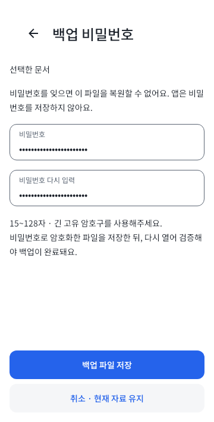
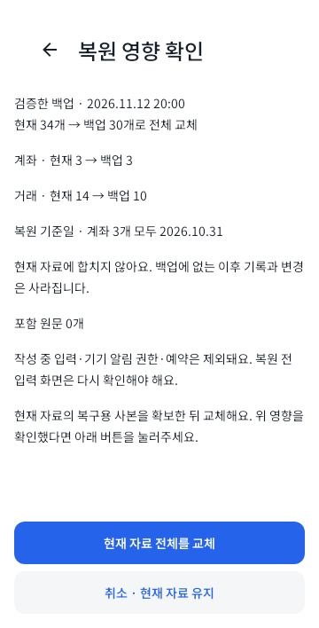
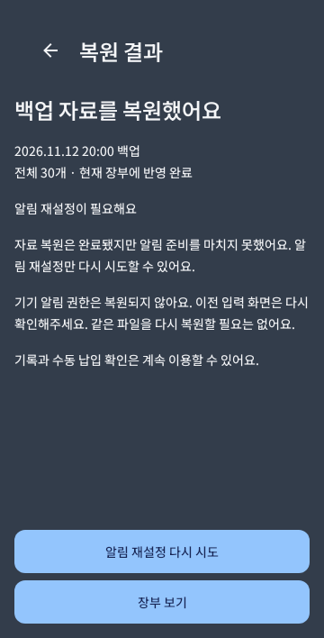
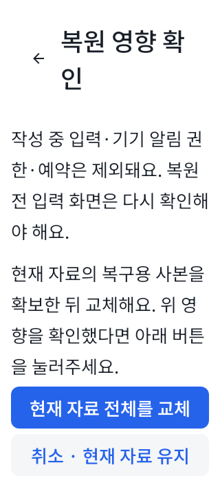

# 백업·복원 검증 인계

Issue #66. 계약과 원자성 설명의 원본은 [core/data/BACKUP.md](../../core/data/BACKUP.md)다. 여기에는 host 결과와 재개 후 기기 시험 경로만 기록한다.

## 기존 QA 자료 보존

복원은 현재 장부 전체를 교체하고 UI 초안 payload를 포함하지 않는다. 따라서 기존 `com.monit.app.qa`의 독립 초안을 백업한 뒤 복원하면 보존할 수 있다고 판단해서는 안 된다. 기존 4개 QA APK/작업 공간과 그 앱 자료를 그대로 둔다.

파괴적 전체 교체를 시험할 전용 `backupQa` 변형은 `com.monit.app.qa.backup`, 표시 이름 `MONIT 백업 검증`을 사용한다. 일반 앱과 기존 QA의 DB·files·Keystore 접근 영역이 분리된다. `./gradlew :app:assembleBackupQa`로 생성하며, `app/build/outputs/apk/backupQa/app-backupQa.apk`가 대상이다. 새 APK의 식별자·서명·hash를 확인하고 **사용자가 기기 작업 재개를 안내한 뒤에만** 설치한다. 기존 QA 앱을 삭제·초기화·강제종료하거나 DB를 덮어쓰지 않는다. 전용 앱에 기존 사용자 백업을 가져오지 않는다.

## 합성 자료로 기기 검증

1. 전용 앱에서만 가상 일반 계좌·가상 저축 계좌, 과거 기준일과 확인 기준액, 가상 수입·이체·반복 납입을 직접 만든다. 개인 금융 정보는 사용하지 않는다.
2. SAF에서 **새 파일**을 선택해 비밀번호를 두 번 입력하고 저장한다. 재읽기 검증 완료와 마지막 검증 시각을 확인한다. 이전 파일을 덮어쓰지 않는다.
3. 가상 거래를 하나 더 추가하고 전용 앱의 버려도 되는 초안을 만든다. 복원 미리보기만으로 자료가 바뀌지 않는지 확인한다.
4. 다른 비밀번호·잘린/변조된 합성 파일·지원하지 않는 파일·접근 권한 회수/제공자 실패에서 교체가 시작되지 않는지 확인한다. 외부 재읽기 실패는 검증 미완료이며 이전 성공 시각이 유지돼야 한다.
5. 정상 파일을 다시 검증하고 전체 교체 영향·건수·생성일·기준일·초안/기기 권한 제외를 읽는다. 취소로 기존 자료를 유지할 수 있는지 확인한 뒤 최종 확인을 직접 누른다. **이 단계에서 버리는 초안은 전용 앱의 합성 초안뿐이다.**
6. 복원 전 추가한 거래와 합성 초안이 사라지고 원래 가상 기록·금액·납입/기준액 이력·알림 선호가 돌아오는지 확인한다. 복원 전 입력 화면·오래된 알림에서 금융 명령을 재실행하지 않아야 한다. 새 백업도 다시 만들어 검증한다.
7. 교체 직후 프로세스 종료/재시작을 시험할 때는 전용 앱만 대상으로 한다. 완료 표식에 따라 결과를 표시하고 같은 전체 교체를 다시 실행하지 않아야 한다. 알림 실패는 복원 성공과 분리하며 알림만 재시도한다.
8. 실제 Keystore 생성/사용, 문서 provider의 쓰기·닫기·재읽기, 스크린샷/최근 앱 차단, 키보드, 200% 글꼴/작은 화면, OS 알림 권한과 재조정을 확인한다. host에서 성공했다고 대체 판정하지 않는다.

원래 QA의 자산/기준액·초안 복구 → 거래/이체/납입 → 전용 앱의 백업/오류/안전한 복원 → 알림/큰 글꼴 순서를 유지한다. 120분 계획에는 발견한 결함의 수정·재빌드나 장시간 알림 관찰을 포함하지 않는다. 현재 기기 조회·설치·권한 변경·시험은 보류 상태다.

## Host 증거

2026-11-13, main `5845a1a` 기준의 Issue #66 변경에서 검증했다. 전체 JUnit XML은 **544개, 실패/오류/건너뜀 0개**다. 신규 백업·복원 47개와 알림 유지보수 회귀 2개가 포함된다. 알림 경계 문제는 수정 전 회귀 실패와 수정 후 성공을 확인했다.

| 검사 | 결과 |
|---|---|
| `ktlintFormat` 뒤 별도 `ktlintCheck` | 통과. 문서/README 자동 포매팅 제외 |
| `:core:model:test testDebugUnitTest` | 전체 544개 통과 |
| `:app:assembleDebug :app:assembleQa :app:assembleBackupQa` | 세 APK 빌드 통과 |
| `lintDebug :app:lintBackupQa` | 통과 |
| textfield family 독립 컴파일 | theme 포함 7개 소스, 다른 프로젝트 classpath 없이 통과 |
| Node CI 분류기 / AI 지침 문서 검사 | 31개 / 26개 문서 통과 |
| strict v2 schema / 별도 OpenSSL vector 재생성 | 기존 파일과 byte/hash 동일 |
| Native host 렌더 | 6조건/7장 확인. 아래 4장 저장 |

전용 APK는 19,587,360바이트이며 SHA-256은 `496A2E79230E70A0AB3DFEB2F62F8C885B45B519188392CB6323FB8D71413819`다. 패키지 `com.monit.app.qa.backup`과 표시 이름 `MONIT 백업 검증`을 APK에서 확인했다. debug 인증서 SHA-256은 `eccc8070141d875ed47bc4a5dedb398c27cd111abaf3ad8880994be6557b8cee`다. strict v1/v2 schema 두 파일이 APK 안에 포함됐음을 확인했다. 설치/기기 실행 결과가 아니다.

실제 파일 Room의 schema7→8 비파괴 이관, 전체 교체 SQL 실패/도중 취소 rollback, 미리보기 revision/generation CAS, commit 뒤 응답 유실/재열기, 원래 요청 v1~v4와 intent 세 상태의 evidence-only 재백업, v1 baseline 원문 bytes/hash·미기록 상태, Unicode/OpenSSL golden vector·GCM 변조·parser/자원 제한을 시험한다. 앱 시험은 stream 닫기/재읽기 실패, 작업 취소·중복 방지, 최종 교체 확인·결과불명 조회·알림만 재시도와 네이티브 host 화면을 포함한다.

Native Canvas 이미지는 합성 자료로 만든 앱 영역이다. 실제 기기나 SAF 화면이 아니다. 다음 이미지는 360dp 일반 글꼴과 320dp/200% 글꼴의 확인 자료다.

