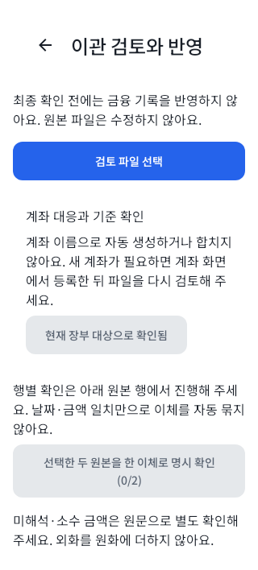
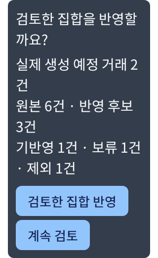
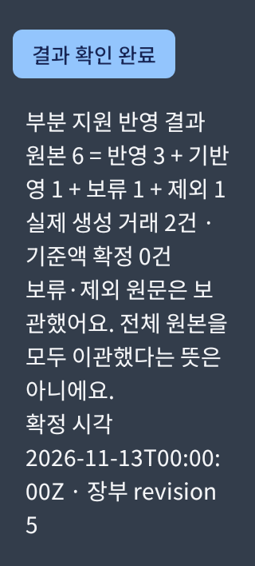

# 이관 writer host 검증

> #69의 host 검증·APK 산출물 이력이다. #69와 후속 S23 수용 결함 수정 #71은 main에 병합됐다. 아래 당시 다음 작업·기기 미실행·hash 기록은 보존하며, 이후 지정 수용시험과 남은 검증은 [현재 안내](../README.md#검증과-남은-일)를 따른다. 실제 자료 반영 PASS를 뜻하지 않는다.

Issue [#68](https://github.com/1971123-seongmin/MONIT/issues/68). 구현 계약은 [이관 writer](../architecture/import-writer-plan.md), 백업 형식·복원 책임은 [BACKUP](../../core/data/BACKUP.md), 입력은 [공개 합성 envelope](../contracts/fixtures/import-preview-v1-synthetic.json)를 따른다. 실제 원본 서비스·사용자 금융 자료·기기는 조회하거나 변경하지 않았다. 기존 QA 작업 공간과 동결 APK도 변경하지 않았다.

## 기준과 결과

- 기준 main: `02f767e`. 원격 main을 다시 확인했으며 같은 기준이라 추가 rebase/merge는 없었다.
- Windows/JBR21, 파일 Room·Robolectric SDK28·Native host Compose 환경에서 확인했다.
- 최종 명령: `./gradlew :core:model:test testDebugUnitTest :app:assembleDebug :app:assembleQa :app:assembleBackupQa :app:lintDebug ktlintCheck --parallel --max-workers=2`.
- 결과: **580 tests, failure 0 / error 0 / skipped 0**, 앱 debug/qa/backupQa 빌드·Android Lint·ktlint 통과. `NO-SOURCE` 작업을 시험 수로 세지 않았다.
- 검증 전후 제품/시험/리소스 입력 SHA256: `26381CCA1F1D123E3ACD60F3575ADF787D93511CC606C1AF5873F3078842531B`로 같았다. 검사 후에는 문서와 Git 메타데이터만 정리했다. 검증 로그의 시간은 캐시를 포함한 실행 시간이며 성능 측정값이 아니다.
- `ktlintFormat` 후 별도 검사를 실행했다. Markdown·DOCS·README를 자동 정렬하지 않았다.
- `node scripts/Generate-ImportBackupSchema.cjs` 재생성 전후 v3 schema hash가 같았다. 문서 검사도 통과했다. 원격 CI 판정은 연결 PR의 최신 head를 확인한다.
- CI에서 드러난 기존 알림 시험의 두 완료 조건을 보완했다. 월별 항목은 목록 준비 뒤 선택하고, 설정은 `READY` 단독 대신 기대한 global/rule/권한 projection→idle→필요한 Lazy 항목 재탐색→실제 변경 문구를 확인한다. 저장 뒤 재조회 전에 이전 projection의 `READY`가 잠시 나타날 수 있고, `LOADING` 동안 비워진 목록은 스크롤 위치가 달라질 수 있기 때문이다.
- 320dp/200% Dark 시험에서 쓰기/조회 gate를 따로 제어해 `SAVING`의 원래 선호, 쓰기 뒤 `LOADING`의 변경된 저장값/이전 projection, 조회 해제 뒤 새 문구·쓰기 1회·금융 제출 0을 단언했다. 제품 알림 코드·기존 assertion·대기 상한은 유지하며 고정 sleep이나 단순 재실행을 사용하지 않았다. 지속 `LOADING`은 여전히 실패한다. 로컬 전체 검증도 CI와 같은 `--parallel --max-workers=2` 옵션으로 확인했다.
- v2의 원래 건수/원문 manifest가 변환 중 덮여 잘못된 선언을 받아들이는 경우를 수정 전 실패로 재현했다. 변환 전에 원래 선언을 대조하도록 고쳐 두 변조 사례가 거부됨을 확인했으며 v1/v2의 미기록 버전 구분도 유지한다.

| 모듈 | 시험 수 |
|---|---:|
| core:common | 10 |
| core:model | 28 |
| core:data | 215 |
| core:navigation | 16 |
| core:designsystem | 35 |
| feature:accounts | 59 |
| feature:home | 21 |
| feature:transactions | 32 |
| app | 164 |

## 확인한 수용 조건

- V9: 같은 출처·원문·매핑과 변경 없는 대상만 EXISTS다. 같은 파일 재검토·반영의 신규 생성은 0이다. 원본 변경, 로컬 메모 수정·논리 삭제, 보관 계좌의 신규 입력은 보류하며 과거 정상 대응은 유지한다. 보관 상태는 아직 별도 보관 UI가 없는 단계의 합성 DB fixture다.
- V10: 무ID 동일 날짜·금액 두 행을 자동 합치지 않는다. 명시 별개 확인 뒤 두 거래를 만들고 같은 파일은 재삽입하지 않는다. 같은 snapshot/locator에서 mapping 버전을 바꿔 이력을 우회하지 못한다. 배열 순서가 다른 추출본은 자동 동일 판정 대신 유사 기록으로 보류한다.
- V11: 원본 **6 = 반영 3 + 기반영 1 + 보류 1 + 제외 1**, 실제 생성 **2**를 확인했다. 명시 이체 두 원본은 한 거래다. 외화 원문은 보관하고 원화 합계에 더하지 않는다.
- V15: 최종 파일 재읽기·장부 revision·백업 영수증 검사를 수행한다. source와 외부 반환 컬렉션 변경이 private 계획을 바꾸지 못한다. SQL의 두 번째 삽입 실패는 금융·대응·child·결과 전부 rollback하며 REQUESTED/원본만 남는다. 취소·응답 유실·재열기는 영속 결과 조회로 이어지고 자동 재실행하지 않는다.
- V26: 이관 요청/행/출처 대응/child와 원래 canonical 요청·영수증·원문·삭제 이력이 백업/복원에서 연결된다. 복원 요청은 evidence-only이고 실행 대기열이 아니다. 이전 백업 복원 뒤 active mapping이 없어도 출처 fence로 자동 부활을 막는다. 모순되는 fence 합집합은 임의 선택 없이 거부한다.
- 실제 checked-in schema8 DDL 파일의 모든 기존 열과 한글/NUL BLOB가 8→9·재열기 뒤 같았다. 이전 백업 시각만으로 새 영수증이 생기지 않고 이관 coverage는 미기록이다.
- 원문 합계 한도 초과를 절단하거나 일부 금융 반영하지 않는다. 실제 2MiB BLOB와 CursorWindow보다 큰 요청 TEXT를 분할 조회해 bytes/문자열/hash를 보존했다. UTF-8이 chunk 경계에서 나뉘는 경우도 포함한다. 큰 임의 TEXT 시험을 업무상 유효한 명령의 증거로 해석하지 않는다.
- 원문과 다른 금액으로 명령·거래·mapping·fence의 해시를 일관되게 다시 만든 파일도 원문 재산출 대조에서 거부했다.

## 화면과 취소 경계

`ImportPreviewJourneyTest`는 파일 선택·기존 탐색 복귀·재검토·큰 글씨 원문 도달을, `ImportWriterJourneyTest`는 실제 Route/VM의 백업 callback과 최종 확인·결과 표시를 시험한다. 화면 시험의 Repository/백업 slot은 합성 대역이며 실제 금융 원자성·SAF·암호화 성공 증거가 아니다. 실제 writer·백업 왕복은 별도 core:data 파일 Room 시험으로 확인했다.

ViewModel 시험은 비복귀 reader와 VM 제거/재생성에서도 실제 작업 완료 전 lease를 유지하고 늦은 결과를 폐기함을 확인한다. 입력 중인 기준액은 비저장 메모리에 유지하고 명시 확인/유지 전에는 반영을 막는다. SavedState에는 조회용 장부 context/batch ID만 남긴다.

시간초과의 수정 전 시험은 첫 읽기 `FAILED` 대신 `LOADING`, 반영 전 재읽기 `STALE` 대신 `APPLYING`, batch 보관 뒤 `RECOVERY` 대신 `APPLYING`으로 실패했다. 내부 timeout을 부모/VM 취소와 구분해 실제 완료 callback에서만 다음 상태를 확정하도록 수정했다. 가상 60초와 실제 `CancellableDocumentAccess`의 비협력 child 정리 gate로 종료 전 lease/중복 차단과 종료 후 명시 재시도를 확인한다. batch 보관 뒤 timeout은 명시 영속 조회만 수행하며 apply는 1회다. 정리 중 장부 변경과 VM 교체는 이전 상태/새 VM을 덮지 않는다. 외부 provider의 즉시 종료·실제 기기 60초 소요를 시험했다는 뜻은 아니다.

아래는 Native host 이미지다. 최종 확인창은 별도 Dialog window의 **320dp·fontScale 2.0** 리소스를 직접 검사했으며 생성 예정 수와 반영 버튼의 표시도 단언했다. 원본 행 수와 생성 거래 수를 분리한다.

| 검토 · Light 320dp/100% | 최종 확인 · Dark 320dp/200% | 결과 · Dark 320dp/200% |
|---|---|---|
|  |  |  |

## QA APK 산출물

현재 작업 공간에서 생성한 로컬 산출물이며 Git에는 포함하지 않는다. 두 APK 모두 versionCode 1/versionName 0.1.0이며 `aapt2 dump badging`의 앱 ID와 metadata가 일치하고 `apksigner verify --verbose --print-certs`를 통과했다. 설치·기기 전송은 하지 않았다.

| 변형 | 앱 ID | APK SHA-256 |
|---|---|---|
| qa · `app-qa.apk` | `com.monit.app.qa` | `492E77BFF1CC831FF8518FBCB8F0383D0B9B32B0D6F92382B40295EE141180C6` |
| backupQa · `app-backupQa.apk` | `com.monit.app.qa.backup` | `6B9DF34A5D2E7D4E7B2819F7E14AAB6577B5CBA2DD50D2A157372E143EDC0040` |

두 산출물의 개발용 서명 인증서 SHA-256은 `ECCC8070141D875ED47BC4A5DEDB398C27CD111ABAF3AD8880994BE6557B8CEE`다. 기존 동결 APK를 교체한 결과가 아니며 실제 기기 동작 검증과 구분한다.

## 남은 검증과 승인 경계

실제 원본 자료의 적합성·완전성·판단, OEM SAF/권한 회수·실제 프로세스 종료·디스크/키 손실·성능 p95·실제 알림은 이 host 결과로 확인하지 않았다. 새 기기 조회·설치·시험은 수행하지 않았다. 기존 기기 QA에서 별도로 발견한 계좌 성격 선택·알림 복귀 결함은 #68과 분리한 다음 후속으로 PM에게 인계한다.

CodeRabbit은 사용자 지속 중단 지시에 따라 OFF이며 요청/대기하지 않는다. PR/최신 CI를 인계하고 최종 병합은 PM의 승인된 흐름에 남긴다.
