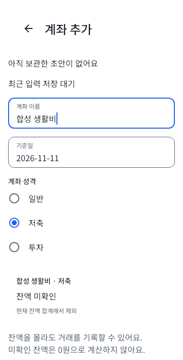
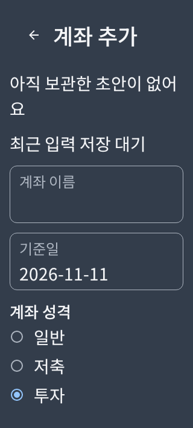

# S23 수용 결함 host 검증

Issue [#70](https://github.com/1971123-seongmin/MONIT/issues/70), 기준 main `b6b3bce`. 신규 계좌 성격 선택과 알림 설정 복귀의 조회 수명만 수정한다. 기존 계좌 성격·기준일·금융 정책·Room schema9·암호/백업/이관 구현은 바꾸지 않았다.

## 계좌 성격 선택

- 일반/저축/투자를 기존 `NatureChanged`로 전달하는 단일 선택 그룹을 추가했다. 선택은 VM 초안에만 두며 저장/복원/호출 화면의 기존 경로를 재사용한다.
- 테마의 48dp 최소 터치 영역과 typography를 적용한 세 개의 Row다. 별도 목록 가상화·상태 복제·항목별 Flow/Effect를 추가하지 않았다. RadioButton의 중복 클릭을 없애고 Row의 선택/비활성 접근성 의미를 사용한다.
- 실제 Route/VM/Nav2의 저축 계좌 등록→사용자 직접 적용→거래 저장, 투자 선택/등록 후 성격 변경 잠금, 취소/보관 후 호출 거래의 raw 입력·선택 보존과 금융 제출 0을 확인한다.
- SavedState의 저축 선택과 별도 기존 영속 초안의 투자 선택 복원, 실제 파일 Room의 일반/저축/투자 등록→DB 재열기 후 성격·기준일·미확인 기준액 보존을 검증한다.

## 알림 재조회와 원인 구분

수정 전 host 시험에서 겹친 요청이 진행 중 조회를 취소했고, 부모 Job이 활성인 조회 자체의 CancellationException은 `FAILED` 대신 `LOADING`을 남겼다. 이는 제어 가능한 VM 경로의 재현이며 S23 내부에서 같은 예외가 발생했다는 근거는 아니다. 기기에서 관찰한 권한 거부/허용·OS 설정 왕복 후 회복은 최종 APK의 QA 결과로 별도 판정한다.

- 권한 응답·생명주기 복귀·DB 관찰의 요청은 진행 중 조회를 완료한 뒤 최신 재조회로 모은다. generation이 다른 중간 결과는 UI에 게시하지 않는다. LAZY Job을 먼저 보관해 재진입 시에도 진행 중 작업을 식별한다.
- 실제 조회/권한 projection을 마친 경우만 READY다. 조회 자체 취소/실패는 명시 실패로 표시하며 부모/VM 취소는 전파한다. 장부/세대 변경·VM 제거 뒤 늦은 값은 폐기한다.
- 서로 다른 두 gate로 첫 조회와 최신 조회를 중단해 직렬 실행·취소 0·최신 조회 전 LOADING·최종 권한/앱/채널/사용자 선호를 단언한다. 독립 조회 취소의 실패/명시 재조회, 장부 변경과 VM 종료의 늦은 응답도 시험한다.
- 강제 READY·예외 무시·고정 sleep·대기 상한 증가·기존 assertion 삭제·재진입 우회는 사용하지 않는다. 설정 조회는 사용자 선호를 쓰지 않으며 금융 쓰기 API를 호출하지 않는다. 기존 실제 알림 Route 시험도 유지한다.

## 로컬 검증

- **588 tests, failure/error/skipped 0**: common10/model28/data217/navigation16/designsystem35/accounts59/home21/transactions32/app170. `NO-SOURCE`를 시험 수로 세지 않았다.
- `:core:model:test testDebugUnitTest`의 전체 시험 결과, `:app:assembleDebug :app:assembleQa :app:assembleBackupQa`, `:app:lintDebug ktlintCheck`의 성공을 대조했다. Windows/JBR21/Robolectric SDK28·파일 Room·Native host 환경이다.
- 새 작업 공간의 로컬 SDK 경로 표기 오류로 Lint가 실패한 뒤, 로컬 경로만 수정하고 앱 Lint 분석을 다시 실행해 통과했다. 제품 소스나 Lint 기준을 완화하지 않았다.
- 시험 보완 뒤 전체 검증 입력 SHA-256은 `982BAAABB9C2E3F91C760BA67FC5570FA691B61DB687946526B97A49F4F26FD5`이며 검사 전후 같았다. Kotlin/KTS/XML/JSON/TOML/gradle.properties를 대상으로 하며 docs/생성물은 제외한다. APK 빌드 당시의 전체 입력 해시와 구분한다.
- `ktlintFormat` 뒤 별도 `ktlintCheck`를 통과했다. DOCS/README/Markdown은 자동 포매팅하지 않았다. 최신 CI는 연결 PR의 정확한 head를 확인한다.

| Light 360dp/100% | Dark 320dp/200% |
|---|---|
|  |  |

실제 Route/VM의 Native host 이미지이며 OS 대화상자나 실기기 성능 증거가 아니다. UI Repository는 합성 대역이고 금융 영속성은 별도 실제 파일 Room 시험으로 구분한다.

초기 CI의 기존 알림 DB 시험은 async a/b의 호출·await 순서를 prepare 확정 순서로 가정했다. b를 먼저 확정시키는 gate에서 기존 `current(first)=false`가 실패함을 재현했다. 일반 병렬 실행은 유지하고 역순 완료 시험을 추가했다. 두 plan 중 실제 current가 정확히 하나이고 나머지가 stale인지, 같은 일별 token/두 멤버인지 확인한 뒤 유효 plan만 applied한다. 재열기 중복0·다음날 AFTER 단언도 유지한다. 이 보완은 시험만 바꾸며 제품 구현을 변경하지 않는다.

## 고정 QA 산출물

두 APK는 versionCode1/versionName0.1.0이고 `aapt2 dump badging`의 앱 ID가 metadata와 일치한다. `apksigner verify --verbose --print-certs`를 통과했으며 개발용 인증서 SHA-256은 기존 QA와 같은 `ECCC8070141D875ED47BC4A5DEDB398C27CD111ABAF3AD8880994BE6557B8CEE`다. APK 자체는 Git에 포함하지 않는다.

APK 빌드 소스는 `45cbb002da51f48168660645c1dd029bc2971401`, 당시 전체 검증 입력은 `A2A0BFE50B0F217A3D3309686A89937443595617BF09DF6547035D346B17577A`다. 이후 시험/문서 보완 때문에 APK를 재빌드하지 않는다. 제품 소스/리소스/빌드 파일 294개의 작업 파일 입력 SHA-256은 `B2DEDDE81BFAFB98FE6923099C6CA30B4508E461B2414E5F413D83DE4EB89208`, 해당 Git blob 목록 SHA-256은 `226902A9C6B645C2632E75177AA58A83CD6E44D757EEB2E4078388FEB27FD1B1`이다. 새 시험 검증 head와 빌드 소스의 제품 tree 동일성·APK 파일 hash 불변을 별도로 대조한다. 소스 연결 근거이며 APK에 commit SHA를 내장했다는 의미는 아니다.

| 변형 | 앱 ID | bytes | APK SHA-256 |
|---|---|---:|---|
| qa | `com.monit.app.qa` | 19,820,849 | `519514E9F0F6AEEA5FC3529528B430275C91DB1152F75B5DB7BF366DFF5C90F4` |
| backupQa | `com.monit.app.qa.backup` | 19,820,865 | `3797782AD73420AB0C0CD9B1DCE577B019EED1EAFCB2F63834FFFC4072463864` |

## 기기 QA와 병합 경계

Android는 기기 조회·설치·파일 전송을 수행하지 않는다. 기존 작업 공간·동결 APK·기존 앱 자료를 보존하고 `.qa`/`.qa.backup` 두 최종 APK의 소스·파일 해시·서명을 QA에 인계한다.

관련 로컬 검사·최신 head CI·PM 검토 뒤 같은 APK에서 S23 두 결함 회귀→schema8→9 보존→합성 이관/중복·대사·복원 fence 검증을 진행한다. 문제없음 확인 뒤 PM이 병합하며 기기 검증 전 auto-merge/병합하지 않는다. CodeRabbit은 OFF를 유지한다. 실제 Notion 반영은 보류한다.
